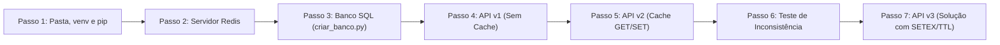

# Guia Prático do Aluno (Passo a Passo Autônomo): Padrão Cache-Aside com Python, SQLite e Redis
## Do Ambiente Virtual (`venv`) e `pip` até a Invalidação Automática com TTL (`SETEX`)

* **Curso:** Tecnologia em Análise e Desenvolvimento de Sistemas (ADS)
* **Disciplina:** Banco de Dados Não-Relacionais (ADS16) — Aula 05
* **Instituição:** Instituto Federal do Ceará (IFCE) — Campus Tauá
* **Docente:** Prof. Me. Reginaldo Fernandes
* **Estudo de Caso:** E-Commerce **ShopGrids** (Categorias em Destaque com Cache-Aside e TTL)

---

## 🎯 O Que Você Vai Construir Neste Guia

Neste tutorial prático, você construirá **do zero** (a partir de uma pasta vazia) uma API em Python com Flask, banco de dados relacional SQLite e cache em memória RAM com **Redis**. O guia é totalmente autônomo: todas as linhas de código estão comentadas e explicadas detalhadamente para que você possa executar e compreender cada etapa por conta própria.

### O Problema de Negócio (Cenário ShopGrids na Black Friday)
1. Na página inicial do e-commerce **ShopGrids**, existe a seção **"Categorias em Destaque"** (`GET /categories/featured`).
2. O banco de dados relacional possui a tabela `categories`, onde a equipe de Marketing marca com `is_featured = 1` apenas as categorias que devem aparecer na vitrine da semana.
3. **O Gargalo:** Sem cache, cada usuário que abre a página inicial dispara um `SELECT` no banco de dados. Em um pico de tráfego como a Black Friday, milhares de requisições idênticas sobrecarregam o disco e as conexões do banco, gerando *Timeout* e derrubando o sistema.
4. **A Solução:** Implementaremos o padrão **Cache-Aside** com **Redis** (que responde em $\approx 100\text{ nanossegundos}$ direto da memória RAM) e resolveremos o problema de dados desatualizados usando **TTL (*Time To Live*)** com o comando `SETEX`.



---

## Passo 1: Preparando o Diretório, Ambiente Virtual (`venv`) e Pacotes via `pip`

### 1.1 Objetivo desta etapa
Criar uma pasta limpa para o projeto, isolar as bibliotecas em um Ambiente Virtual Python (`.venv`) para não interferir no sistema operacional e instalar o microframework web `flask` e o driver `redis`.

### 1.2 Comandos no Terminal
Abra o seu terminal e execute os comandos abaixo, um por vez:

```bash
# 1. Cria a pasta do projeto chamada 'shopgrids-cache'
mkdir shopgrids-cache

# 2. Entra na pasta recém-criada
cd shopgrids-cache

# 3. Cria o ambiente virtual Python dentro da pasta oculta '.venv'
python3 -m venv .venv

# 4. Ativa o ambiente virtual no Linux / macOS
# (Se estiver no Windows PowerShell, use: .venv\Scripts\Activate.ps1)
source .venv/bin/activate

# 5. Atualiza o gerenciador de pacotes pip para a versão mais recente
pip install --upgrade pip

# 6. Instala o Flask (servidor web/API) e o cliente oficial do Redis (redis-py)
pip install flask redis

# 7. Gera o arquivo requirements.txt registrando as versões exatas instaladas
pip freeze > requirements.txt
```

### 1.3 Função de Cada Comando
* `mkdir shopgrids-cache` e `cd shopgrids-cache`: Cria o diretório de trabalho e posiciona o terminal dentro dele.
* `python3 -m venv .venv`: Executa o módulo nativo `venv` do Python para criar uma cópia isolada do interpretador Python e do `pip` dentro da subpasta `.venv`.
* `source .venv/bin/activate`: Ativa o ambiente virtual na sessão atual do terminal. Você verá o prefixo `(.venv)` aparecer no início da linha de comando.
* `pip install flask redis`: Baixa e instala dois pacotes essenciais:
  * **`flask`**: Responsável por expor as rotas HTTP da nossa API na porta `5000`.
  * **`redis`**: Biblioteca `redis-py` que se comunica com o servidor Redis através do protocolo binário **RESP** (*Redis Serialization Protocol*) via TCP.
* `pip freeze > requirements.txt`: Lista todas as bibliotecas instaladas no ambiente virtual e salva no arquivo `requirements.txt`, permitindo que qualquer outro desenvolvedor recrie o ambiente com `pip install -r requirements.txt`.

---

## Passo 2: Verificando a Conexão com o Servidor Redis

### 2.1 Objetivo desta etapa
Garantir que o servidor **Redis** está ativo na porta padrão `6379` e que o nosso ambiente virtual Python consegue se comunicar com ele.

### 2.2 Comandos no Terminal

```bash
# 1. Envia um comando PING para o servidor Redis via terminal
redis-cli ping
```

**Saída Esperada:**
```text
PONG
```

> [!TIP]
> **E se o comando acima retornar erro de conexão (`Could not connect to Redis`)?**  
> Basta iniciar o serviço do Redis localmente ou subir um container Docker com um dos comandos abaixo:
> ```bash
> # Opção A — Iniciar serviço local no Linux:
> redis-server --daemonize yes
> 
> # Opção B — Subir via Docker:
> docker run -d --name redis-aula -p 6379:6379 redis:7.4-alpine
> ```

Agora, execute este comando para testar a comunicação entre o seu Python (`.venv`) e o Redis:

```bash
# 2. Testa a conexão usando a biblioteca 'redis' instalada no Passo 1
python -c "import redis; r = redis.Redis(host='localhost', port=6379, decode_responses=True); print('Redis conectado:', r.ping())"
```

**Saída Esperada:**
```text
Redis conectado: True
```

---

## Passo 3: Criando o Banco de Dados Relacional (`criar_banco.py`)

### 3.1 Objetivo desta etapa
Criar o banco de dados relacional `shopgrids.db` (usando o `sqlite3` nativo do Python) com a tabela `categories`. Vamos inserir 6 categorias no total: as **4 primeiras** estarão marcadas como destaque (`is_featured = 1`) e as **2 últimas** (categorias de inverno) estarão desmarcadas (`is_featured = 0`).

### 3.2 Código Completo do Arquivo `criar_banco.py`
Dentro da pasta `shopgrids-cache`, crie um arquivo chamado `criar_banco.py` com o código abaixo:

```python
# Arquivo: criar_banco.py
# Objetivo: Criar o banco de dados SQLite 'shopgrids.db' e popular a tabela 'categories'

# Importa a biblioteca nativa do Python para banco de dados relacional SQLite
import sqlite3

# Define a função que criará a estrutura da tabela e os registros iniciais
def inicializar_banco():
    # Conecta ao arquivo 'shopgrids.db' (cria o arquivo no disco caso ainda não exista)
    conn = sqlite3.connect("shopgrids.db")
    
    # Cria o objeto cursor, responsável por enviar comandos SQL ao banco de dados
    cursor = conn.cursor()

    # Remove a tabela 'categories' se ela já existir, garantindo que o teste comece limpo
    cursor.execute("DROP TABLE IF EXISTS categories")

    # Cria a tabela 'categories' com 4 colunas (id, name, image, is_featured)
    cursor.execute("""
        CREATE TABLE categories (
            id INTEGER PRIMARY KEY,                 -- Identificador único da categoria
            name TEXT NOT NULL,                     -- Nome exibido no Front-end
            image TEXT NOT NULL,                    -- Nome da imagem/ícone da categoria
            is_featured INTEGER NOT NULL DEFAULT 0  -- 1 = Em destaque na Home | 0 = Não destacada
        )
    """)

    # Lista de tuplas com as 6 categorias iniciais da loja ShopGrids:
    # As 4 primeiras possuem is_featured = 1 (aparecem na Home)
    # As 2 últimas possuem is_featured = 0 (ocultas inicialmente)
    categorias = [
        (1, "TV & Áudio", "tv-audio.png", 1),          # Destaque ativo (1)
        (2, "Desktop & Laptop", "laptop.png", 1),      # Destaque ativo (1)
        (3, "Smartphones", "smartphone.png", 1),       # Destaque ativo (1)
        (4, "Acessórios Gamer", "gamer.png", 1),       # Destaque ativo (1)
        (5, "Moda Inverno", "inverno.png", 0),         # Destaque inativo (0)
        (6, "Aquecedores", "aquecedor.png", 0),        # Destaque inativo (0)
    ]

    # Insere todas as 6 categorias de uma só vez substituindo os '?' pelos dados de cada tupla
    cursor.executemany(
        "INSERT INTO categories (id, name, image, is_featured) VALUES (?, ?, ?, ?)",
        categorias
    )

    # Grava (commita) as alterações permanentemente no arquivo 'shopgrids.db'
    conn.commit()
    
    # Encerra a conexão com o arquivo do banco de dados
    conn.close()
    
    # Informa no terminal que o banco foi preparado com sucesso
    print("✓ Banco 'shopgrids.db' criado com sucesso com 6 categorias (4 em destaque)!")

# Executa a função quando o arquivo é chamado diretamente pelo comando 'python criar_banco.py'
if __name__ == "__main__":
    inicializar_banco()
```

### 3.3 Função de Cada Linha do Código
* `import sqlite3`: Carrega o driver SQL embutido no Python (não requer instalação externa de SGBD).
* `conn = sqlite3.connect("shopgrids.db")`: Abre ou cria o arquivo físico do banco relacional no diretório atual.
* `cursor.execute("DROP TABLE IF EXISTS categories")`: Evita erros de chave duplicada caso você execute o script mais de uma vez.
* `CREATE TABLE categories (...)`: Cria a estrutura relacional onde a coluna `is_featured` (`1` ou `0`) define quais categorias aparecem na vitrine.
* `cursor.executemany(...)`: Executa múltiplos comandos `INSERT` em uma única transação segura contra *SQL Injection* (usando placeholders `?`).
* `conn.commit()` e `conn.close()`: Salva os dados em disco e libera o arquivo.

### 3.4 Executando e Testando no Terminal
Execute o script:

```bash
python criar_banco.py
```

**Saída Esperada:**
```text
✓ Banco 'shopgrids.db' criado com sucesso com 6 categorias (4 em destaque)!
```

---

## Passo 4: Construindo a Versão 1 do `app.py` (Sem Cache — Consultando Direto no Banco SQL)

### 4.1 Objetivo desta etapa
Criar a primeira versão da nossa API (`app.py`) **sem Redis**. Toda requisição enviada para `GET /categories/featured` fará um `SELECT` diretamente no banco de dados `shopgrids.db`. Também criaremos duas rotas auxiliares (`/categories/inverno` e `/categories/blackfriday`) que simulam a equipe de Produto alterando as categorias em destaque diretamente no banco SQL.

### 4.2 Código Completo do `app.py` (Versão 1 — Sem Cache)
Crie o arquivo `app.py` na pasta `shopgrids-cache` com o seguinte conteúdo:

```python
# Arquivo: app.py (VERSÃO 1 — SEM CACHE: TODA REQUISIÇÃO BATE NO BANCO DE DADOS SQL)

# Importa o driver SQLite para consultar o arquivo de banco de dados em disco
import sqlite3
# Importa o módulo time para medir o tempo de resposta e simular a lentidão do disco
import time
# Importa o Flask para criar o servidor web e jsonify para formatar a saída como JSON
from flask import Flask, jsonify

# Inicializa a aplicação web Flask
app = Flask(__name__)


# Função que acessa o banco de dados relacional e filtra as categorias em destaque
def buscar_categorias_no_banco():
    # Pausa por 80 milissegundos (0.08s) simulando a latência de leitura em disco e fila de conexões SQL
    time.sleep(0.08)

    # Abre conexão com o banco de dados relacional no disco
    conn = sqlite3.connect("shopgrids.db")
    
    # Permite que as linhas retornadas pelo SQLite sejam acessadas pelo nome da coluna (como dicionários)
    conn.row_factory = sqlite3.Row
    
    # Cria o cursor para execução da query SQL
    cursor = conn.cursor()

    # Consulta SQL que busca apenas as categorias marcadas como destaque (is_featured = 1)
    cursor.execute("SELECT id, name, image, is_featured FROM categories WHERE is_featured = 1")
    
    # Converte cada registro retornado pelo banco em um dicionário Python padrão
    categorias = [dict(row) for row in cursor.fetchall()]

    # Fecha a conexão com o banco de dados
    conn.close()
    
    # Devolve a lista de categorias encontradas
    return categorias


# Rota principal chamada pelo Front-end para exibir as Categorias em Destaque
@app.route("/categories/featured", methods=["GET"])
def get_featured_categories():
    # Registra o instante exato de início do processamento da requisição
    inicio = time.time()

    # GARGALO: Executa a consulta no banco de dados SQL em 100% das requisições!
    categorias = buscar_categorias_no_banco()

    # Calcula o tempo total gasto em milissegundos (arredondado para 2 casas decimais)
    tempo_ms = round((time.time() - inicio) * 1000, 2)

    # Retorna o JSON com os dados e a telemetria da requisição
    return jsonify({
        "origem": "BANCO_DE_DADOS (SQL)",  # Mostra que veio direto do banco em disco
        "tempo_ms": tempo_ms,              # Tempo gasto na consulta (~80 ms)
        "total": len(categorias),          # Total de categorias retornadas
        "dados": categorias                # Lista das categorias em destaque
    })


# Rota auxiliar (POST): Simula o time de Produto alterando o banco para o cenário de Inverno (2 categorias)
@app.route("/categories/inverno", methods=["POST"])
def ativar_categorias_inverno():
    # Conecta ao banco de dados SQLite
    conn = sqlite3.connect("shopgrids.db")
    # Desmarca todas as categorias no banco (is_featured = 0)
    conn.execute("UPDATE categories SET is_featured = 0")
    # Marca apenas 'Moda Inverno' (id 5) e 'Aquecedores' (id 6) como destaque (is_featured = 1)
    conn.execute("UPDATE categories SET is_featured = 1 WHERE id IN (5, 6)")
    # Salva as alterações no banco de dados
    conn.commit()
    # Fecha a conexão
    conn.close()
    # Retorna mensagem confirmando a atualização no banco SQL
    return jsonify({"mensagem": "Banco SQL atualizado: apenas 2 categorias de inverno em destaque!"})


# Rota auxiliar (POST): Simula o time de Produto ativando todas as 6 categorias para a Black Friday
@app.route("/categories/blackfriday", methods=["POST"])
def ativar_todas_categorias():
    # Conecta ao banco de dados SQLite
    conn = sqlite3.connect("shopgrids.db")
    # Marca todas as 6 categorias com is_featured = 1 no banco
    conn.execute("UPDATE categories SET is_featured = 1")
    # Salva as alterações no banco de dados
    conn.commit()
    # Fecha a conexão
    conn.close()
    # Retorna mensagem confirmando a atualização no banco SQL
    return jsonify({"mensagem": "Banco SQL atualizado: todas as 6 categorias em destaque!"})


# Inicia o servidor Flask na porta 5000 com recarregamento automático (debug=True)
if __name__ == "__main__":
    app.run(port=5000, debug=True)
```

### 4.3 Função de Cada Bloco do Código
* `time.sleep(0.08)`: Simula o tempo real de resposta de um banco relacional sob carga moderada (leitura em disco + verificação de índices e transações).
* `conn.row_factory = sqlite3.Row`: Sem esta linha, o SQLite retornaria tuplas simples `(1, 'TV & Áudio', ...)`. Com `sqlite3.Row`, conseguimos converter facilmente cada linha para um dicionário `{"id": 1, "name": "TV & Áudio", ...}` usando `dict(row)`.
* `tempo_ms = round((time.time() - inicio) * 1000, 2)`: Mede o tempo decorrido desde o início da função e multiplica por `1000` para converter de segundos para milissegundos.
* Rotas `/categories/inverno` e `/categories/blackfriday`: Alteram **exclusivamente o banco de dados SQLite**, exatamente como ocorreria se um administrador alterasse os registros em um painel administrativo externo.

### 4.4 Executando e Testando a Versão 1
No **Terminal 1** (com o `.venv` ativo), inicie o servidor:

```bash
python app.py
```

Abra uma **segunda janela de terminal (Terminal 2)** e faça a requisição para a API:

```bash
curl -s http://localhost:5000/categories/featured | jq .
```
*(Dica: Se não tiver o utilitário `jq` instalado para colorir o JSON, basta rodar `curl http://localhost:5000/categories/featured` ou abrir `http://localhost:5000/categories/featured` no navegador).*

**Saída Esperada:**
```json
{
  "dados": [
    { "id": 1, "image": "tv-audio.png", "is_featured": 1, "name": "TV & Áudio" },
    { "id": 2, "image": "laptop.png", "is_featured": 1, "name": "Desktop & Laptop" },
    { "id": 3, "image": "smartphone.png", "is_featured": 1, "name": "Smartphones" },
    { "id": 4, "image": "gamer.png", "is_featured": 1, "name": "Acessórios Gamer" }
  ],
  "origem": "BANCO_DE_DADOS (SQL)",
  "tempo_ms": 81.52,
  "total": 4
}
```
Observe que todas as chamadas levam mais de **80 ms** e batem diretamente no banco de dados SQL.

---

## Passo 5: Evoluindo para a Versão 2 do `app.py` (Cache-Aside com `GET` e `SET`)

### 5.1 Objetivo desta etapa
Implementar o padrão **Cache-Aside**:
1. Quando uma requisição chega em `/categories/featured`, a API consulta primeiro a chave `featured_categories` no **Redis** (`r.get()`).
2. **Se existir no Redis (*Cache Hit*):** converte a String JSON de volta para lista (`json.loads()`) e retorna imediatamente da memória RAM sem tocar no banco SQL!
3. **Se não existir no Redis (*Cache Miss*):** consulta o banco de dados SQL, salva uma cópia do resultado no Redis em formato texto JSON (`r.set()`) e retorna para o usuário.

### 5.2 Código Completo do `app.py` (Versão 2 — Com `GET` e `SET`)
Substitua o código do seu arquivo `app.py` pela versão abaixo (basta salvar o arquivo que o Flask reiniciará sozinho no Terminal 1):

```python
# Arquivo: app.py (VERSÃO 2 — PADRÃO CACHE-ASIDE COM GET E SET SEM EXPIRAÇÃO)

# [NOVO] Importa o módulo json para converter listas Python em texto JSON (dumps) e vice-versa (loads)
import json
import sqlite3
import time
from flask import Flask, jsonify
# [NOVO] Importa a biblioteca cliente do Redis
import redis

app = Flask(__name__)

# [NOVO] Conecta ao servidor Redis local na porta 6379 (banco 0)
# decode_responses=True faz o Redis retornar Strings normais do Python em vez de bytes (b'...')
r = redis.Redis(host="localhost", port=6379, db=0, decode_responses=True)


def buscar_categorias_no_banco():
    # Simula 80ms de leitura em disco no banco relacional
    time.sleep(0.08)
    conn = sqlite3.connect("shopgrids.db")
    conn.row_factory = sqlite3.Row
    cursor = conn.cursor()
    cursor.execute("SELECT id, name, image, is_featured FROM categories WHERE is_featured = 1")
    categorias = [dict(row) for row in cursor.fetchall()]
    conn.close()
    return categorias


@app.route("/categories/featured", methods=["GET"])
def get_featured_categories():
    # Marca o instante inicial da requisição
    inicio = time.time()

    # [NOVO] Define a chave única que identificará as categorias em destaque dentro do Redis
    cache_key = "featured_categories"

    # [NOVO] 1. Tenta buscar os dados primeiro na memória RAM do Redis (comando GET)
    cached_categories = r.get(cache_key)

    # [NOVO] 2. Se 'cached_categories' não for vazio (CACHE HIT), retorna imediatamente da RAM!
    if cached_categories:
        # Converte o texto JSON armazenado no Redis de volta para uma lista Python
        lista_categorias = json.loads(cached_categories)
        # Calcula o tempo gasto (será inferior a 1 milissegundo!)
        tempo_ms = round((time.time() - inicio) * 1000, 2)
        # Devolve a resposta sem executar nenhuma linha de banco de dados SQL
        return jsonify({
            "origem": "CACHE_REDIS (Memória RAM)",
            "tempo_ms": tempo_ms,
            "total": len(lista_categorias),
            "dados": lista_categorias
        })

    # 3. Se não encontrou no Redis (CACHE MISS), vai ao banco de dados SQL buscar os registros
    categorias = buscar_categorias_no_banco()

    # [NOVO] 4. Salva uma cópia do resultado no Redis usando json.dumps() para transformar a lista em String
    r.set(cache_key, json.dumps(categorias))

    # Calcula o tempo total desta requisição que precisou ir ao banco SQL
    tempo_ms = round((time.time() - inicio) * 1000, 2)

    # Retorna os dados buscados no banco
    return jsonify({
        "origem": "BANCO_DE_DADOS (SQL)",
        "tempo_ms": tempo_ms,
        "total": len(categorias),
        "dados": categorias
    })


@app.route("/categories/inverno", methods=["POST"])
def ativar_categorias_inverno():
    conn = sqlite3.connect("shopgrids.db")
    conn.execute("UPDATE categories SET is_featured = 0")
    conn.execute("UPDATE categories SET is_featured = 1 WHERE id IN (5, 6)")
    conn.commit()
    conn.close()
    return jsonify({"mensagem": "Banco SQL atualizado: apenas 2 categorias de inverno em destaque!"})


@app.route("/categories/blackfriday", methods=["POST"])
def ativar_todas_categorias():
    conn = sqlite3.connect("shopgrids.db")
    conn.execute("UPDATE categories SET is_featured = 1")
    conn.commit()
    conn.close()
    return jsonify({"mensagem": "Banco SQL atualizado: todas as 6 categorias em destaque!"})


if __name__ == "__main__":
    app.run(port=5000, debug=True)
```

### 5.3 Função de Cada Linha Adicionada
* `r = redis.Redis(host="localhost", port=6379, db=0, decode_responses=True)`: Abre o pool de conexão TCP com o Redis. O argumento `decode_responses=True` é indispensável em Python para que o retorno de `r.get()` já venha decodificado em UTF-8 (`str`).
* `cached_categories = r.get(cache_key)`: Consulta em tempo $O(1)$ se a chave `"featured_categories"` existe na memória do Redis. Se não existir, retorna `None`.
* `json.dumps(categorias)` e `json.loads(cached_categories)`: O comando `SET` do Redis armazena valores do tipo **String**. Por isso, serializamos a lista de dicionários para uma String JSON ao gravar (`dumps`) e desserializamos de volta para lista ao ler (`loads`).

### 5.4 Testando na Prática (Cache Miss vs. Cache Hit)
No **Terminal 2**, execute duas chamadas seguidas:

```bash
# 1ª Chamada (O Redis está vazio -> Vai ao Banco SQL e grava no Redis):
curl -s http://localhost:5000/categories/featured | jq '{origem, tempo_ms, total}'

# 2ª Chamada (Já está salvo no Redis -> Vem direto da Memória RAM!):
curl -s http://localhost:5000/categories/featured | jq '{origem, tempo_ms, total}'
```

**Saída Esperada:**
```json
// 1ª Chamada:
{
  "origem": "BANCO_DE_DADOS (SQL)",
  "tempo_ms": 82.14,
  "total": 4
}

// 2ª Chamada:
{
  "origem": "CACHE_REDIS (Memória RAM)",
  "tempo_ms": 0.41,
  "total": 4
}
```
> **Resultado:** O tempo de resposta caiu de **82,14 ms** para **0,41 ms** ($\approx 200\times$ mais rápido!) e o banco de dados SQL foi completamente aliviado.

Você também pode inspecionar o valor salvo diretamente no Redis:
```bash
redis-cli GET featured_categories
```

---

## Passo 6: Reproduzindo o Problema da Inconsistência de Dados

### 6.1 Objetivo desta etapa
Compreender o erro arquitetural de usar `r.set()` sem definir um tempo de expiração: quando os dados mudam no banco de dados relacional, o cache continua entregando dados antigos (defasados) para sempre.

### 6.2 Simulando uma Atualização no Banco de Dados
Imagine que chegou o inverno e a equipe de Produto alterou o banco de dados para deixar **apenas 2 categorias** em destaque (*Moda Inverno* e *Aquecedores*).

No **Terminal 2**, execute o comando abaixo para atualizar o banco SQLite:

```bash
# 1. Atualiza o banco SQL para deixar apenas 2 categorias de inverno com is_featured = 1
curl -s -X POST http://localhost:5000/categories/inverno | jq .
```

Agora, consulte novamente a rota de categorias em destaque da API:

```bash
# 2. Consulta a vitrine da API
curl -s http://localhost:5000/categories/featured | jq '{origem, tempo_ms, total, dados}'
```

**Saída Obtida (Observe a Inconsistência!):**
```json
{
  "origem": "CACHE_REDIS (Memória RAM)",
  "tempo_ms": 0.39,
  "total": 4,
  "dados": [
    { "id": 1, "name": "TV & Áudio", ... },
    { "id": 2, "name": "Desktop & Laptop", ... },
    { "id": 3, "name": "Smartphones", ... },
    { "id": 4, "name": "Acessórios Gamer", ... }
  ]
}
```

### 6.3 Por que o bug aconteceu?
1. O banco SQLite foi atualizado e agora possui apenas **2 categorias** com `is_featured = 1`.
2. Porém, como a chave `featured_categories` foi salva no Passo 5 com `r.set()` **sem prazo de validade**, o seu tempo de vida no Redis é infinito (`TTL = -1`).
3. Toda requisição que chega na API entra no bloco `if cached_categories:` e retorna as **4 categorias antigas** da memória RAM, nunca mais consultando o banco SQL!

Confirme no terminal que a chave não tem expiração (`-1`):
```bash
redis-cli TTL featured_categories
# Saída: (integer) -1
```

---

## Passo 7: Versão 3 Final do `app.py` — Solução com Invalidação por Tempo (`SETEX` / TTL)

### 7.1 Objetivo desta etapa
Resolver o problema da inconsistência substituindo `r.set()` por **`r.setex()`**, definindo um **TTL (*Time To Live* — Tempo de Vida)** de **20 segundos**. Assim, após 20 segundos, o próprio Redis apaga a chave automaticamente da memória RAM, fazendo com que a requisição seguinte busque os dados atualizados no banco SQL.

### 7.2 Código Completo do `app.py` (Versão 3 Final — Com `SETEX` e `TTL`)
Atualize o arquivo `app.py` com o código final abaixo:

```python
# Arquivo: app.py (VERSÃO 3 FINAL — CACHE-ASIDE COM SETEX E EXPIRAÇÃO AUTOMÁTICA TTL DE 20s)

# Importa o módulo json para conversão entre listas Python e Strings JSON
import json
# Importa o módulo sqlite3 para acesso ao banco de dados relacional em disco
import sqlite3
# Importa o módulo time para medição de latência em milissegundos
import time
# Importa Flask e jsonify para criação da API HTTP
from flask import Flask, jsonify
# Importa o cliente oficial do Redis
import redis

# Instancia a aplicação Flask
app = Flask(__name__)

# Conecta ao servidor Redis local na porta 6379 com decodificação automática para String
r = redis.Redis(host="localhost", port=6379, db=0, decode_responses=True)


# Função que realiza o SELECT no banco de dados SQLite
def buscar_categorias_no_banco():
    # Simula 80ms de latência de banco de dados em disco
    time.sleep(0.08)
    conn = sqlite3.connect("shopgrids.db")
    conn.row_factory = sqlite3.Row
    cursor = conn.cursor()
    cursor.execute("SELECT id, name, image, is_featured FROM categories WHERE is_featured = 1")
    categorias = [dict(row) for row in cursor.fetchall()]
    conn.close()
    return categorias


# Endpoint principal com Cache-Aside e expiração automática (TTL)
@app.route("/categories/featured", methods=["GET"])
def get_featured_categories():
    # Registra o instante de início da requisição
    inicio = time.time()
    
    # Nome da chave armazenada no Redis
    cache_key = "featured_categories"

    # 1. Consulta o Redis primeiro (Memória RAM)
    cached_categories = r.get(cache_key)

    # 2. Se a chave existir no Redis (CACHE HIT), retorna imediatamente da RAM
    if cached_categories:
        # Converte a String JSON de volta para lista Python
        lista_categorias = json.loads(cached_categories)
        # Calcula o tempo de resposta em milissegundos
        tempo_ms = round((time.time() - inicio) * 1000, 2)
        # Retorna os dados do cache junto com o TTL restante (quantos segundos faltam para expirar)
        return jsonify({
            "origem": "CACHE_REDIS (Memória RAM)",
            "tempo_ms": tempo_ms,
            "ttl_segundos": r.ttl(cache_key),  # Consulta no Redis o tempo de vida restante da chave
            "total": len(lista_categorias),
            "dados": lista_categorias
        })

    # 3. Se a chave não existir ou já tiver expirado (CACHE MISS), busca no banco SQL
    categorias = buscar_categorias_no_banco()

    # [SOLUÇÃO COM TTL] 4. Grava no Redis usando SETEX com tempo de vida de 20 segundos!
    # Parâmetros: r.setex(nome_da_chave, tempo_em_segundos, valor_json)
    # Após 20 segundos, a chave desaparece sozinha da memória RAM.
    r.setex(cache_key, 20, json.dumps(categorias))

    # Calcula o tempo total gasto
    tempo_ms = round((time.time() - inicio) * 1000, 2)

    # Retorna os dados recém-buscados do banco SQL
    return jsonify({
        "origem": "BANCO_DE_DADOS (SQL)",
        "tempo_ms": tempo_ms,
        "ttl_segundos": 20,
        "total": len(categorias),
        "dados": categorias
    })


# Rota auxiliar para ativar apenas as 2 categorias de inverno no banco SQL
@app.route("/categories/inverno", methods=["POST"])
def ativar_categorias_inverno():
    conn = sqlite3.connect("shopgrids.db")
    conn.execute("UPDATE categories SET is_featured = 0")
    conn.execute("UPDATE categories SET is_featured = 1 WHERE id IN (5, 6)")
    conn.commit()
    conn.close()
    return jsonify({"mensagem": "Banco SQL atualizado: apenas 2 categorias de inverno em destaque!"})


# Rota auxiliar para ativar todas as 6 categorias no banco SQL (Black Friday)
@app.route("/categories/blackfriday", methods=["POST"])
def ativar_todas_categorias():
    conn = sqlite3.connect("shopgrids.db")
    conn.execute("UPDATE categories SET is_featured = 1")
    conn.commit()
    conn.close()
    return jsonify({"mensagem": "Banco SQL atualizado: todas as 6 categorias em destaque!"})


if __name__ == "__main__":
    app.run(port=5000, debug=True)
```

### 7.3 Função das Novas Instruções
* `r.setex(cache_key, 20, json.dumps(categorias))`: Executa de forma atômica a gravação da chave e a definição do seu cronômetro de expiração (**TTL**) para **20 segundos**.
* `r.ttl(cache_key)`: Retorna um número inteiro indicando quantos segundos restam antes que o Redis delete a chave automaticamente da memória RAM.

### 7.4 Teste Prático Completo da Expiração Automática (TTL)
Siga a sequência abaixo no **Terminal 2**:

**1º) Remova a chave antiga (que estava sem TTL do Passo 5):**
```bash
redis-cli DEL featured_categories
```

**2º) Faça uma consulta na API (ela buscará as 2 categorias de inverno no banco e iniciará o TTL de 20s):**
```bash
curl -s http://localhost:5000/categories/featured | jq '{origem, tempo_ms, ttl_segundos, total}'
```
Saída:
```json
{
  "origem": "BANCO_DE_DADOS (SQL)",
  "tempo_ms": 81.90,
  "ttl_segundos": 20,
  "total": 2
}
```

**3º) Antes de passarem os 20 segundos, atualize o banco SQL para ter 6 categorias (Black Friday):**
```bash
curl -s -X POST http://localhost:5000/categories/blackfriday | jq .
```

**4º) Consulte a API repetidamente a cada 3 segundos e observe o `ttl_segundos`:**
```bash
curl -s http://localhost:5000/categories/featured | jq '{origem, tempo_ms, ttl_segundos, total}'
```
* **Enquanto os 20 segundos não terminam (`ttl_segundos: 14, 11, 7...`):** A API responde em `~0.4 ms` (`CACHE_REDIS`) retornando `total: 2`.
* **Assim que os 20 segundos expiram:** A chave some da RAM automaticamente! Na chamada seguinte, a API vai ao `BANCO_DE_DADOS (SQL)`, busca as **6 categorias novas** (`total: 6`) e já inicia um novo ciclo de 20 segundos de cache!

---

## Passo 8: Resumo de Arquitetura — Os 3 Critérios Obrigatórios para Usar Cache

A memória RAM do servidor é limitada e compartilhada. Antes de colocar qualquer consulta em cache no Redis, verifique se o dado atende simultaneamente a estas **3 regras**:

| Critério | Quando USAR Cache (Ex.: Categorias em Destaque) | Quando NÃO USAR Cache (Ex.: Saldo Bancário / Pix) |
| :--- | :--- | :--- |
| **1. Frequência de Leitura** | **Muito requisitado:** Milhares de clientes acessam a Home a cada minuto buscando exatamente a mesma lista. | Dados raramente consultados (ex.: extrato de 5 anos atrás) só desperdiçam memória RAM. |
| **2. Frequência de Escrita** | **Muda pouco:** O time de Marketing altera as categorias em destaque apenas uma vez por semana ou mês. | Dados que mudam a cada segundo invalidam o cache o tempo todo, tornando-o inútil. |
| **3. Consistência** | **Tolera Consistência Eventual:** Um atraso de 20 segundos (TTL) para exibir uma nova categoria na vitrine não causa prejuízo. | **Exige Consistência Forte (Quente):** Se um cliente tem R$ 1.000 e faz um Pix de R$ 1.000, o saldo **não pode** continuar mostrando R$ 1.000 por 20 segundos até o cache expirar! |
