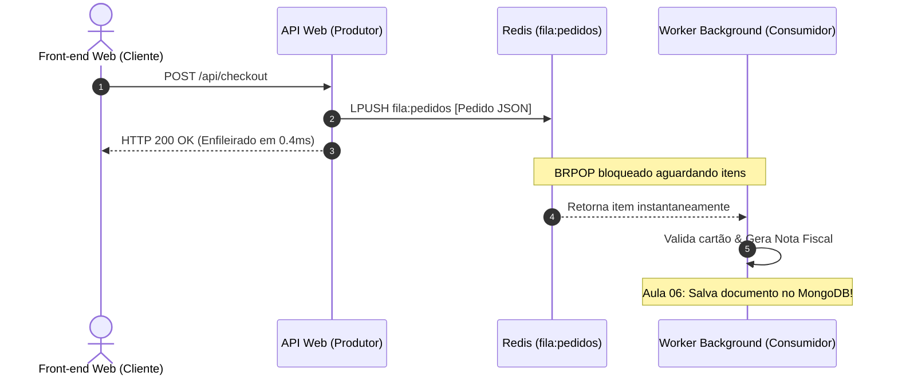

# Tutorial de Construção Passo a Passo: FastCommerce NoSQL
## Do Front-end à Persistência com Redis (Método "Construindo e Testando")

* **Curso:** Tecnologia em Análise e Desenvolvimento de Sistemas (ADS)
* **Disciplina:** Banco de Dados Não-Relacionais (ADS16) — Aula 05
* **Instituição:** Instituto Federal do Ceará (IFCE) — Campus Tauá
* **Docente:** Prof. Me. Reginaldo Fernandes
* **Projeto:** FastCommerce NoSQL (Arquitetura Chave-Valor & Persistência Poliglota)

---

## 🧭 Metodologia Deste Guia

Este tutorial adota a metodologia de **Engenharia Incremental Guiada por Testes de Saída**:
1. **Necessidade Técnica:** Antes de qualquer código, explicamos *qual problema real de negócio* estamos enfrentando (ex.: lentidão de banco em disco, concorrência no carrinho, travamento de requisição).
2. **Código da Etapa:** Código enxuto, direto e funcional.
3. **Por que de Cada Linha:** Detalhamento do propósito de cada instrução, biblioteca e parâmetro.
4. **Histórico de Construção:** Registro explícito do que mudou em relação à etapa anterior e os motivos técnicos da evolução.
5. **Teste Prático & Saída Esperada:** Comandos no terminal (`curl`, Python ou `redis-cli`) e como validar visualmente a resposta exata.

```mermaid
flowchart LR
    A["Etapa 1: Ambiente & Redis Ping"] --> B["Etapa 2: Servidor Web & Vitrine"]
    B --> C["Etapa 3: Sessão com TTL (SETEX)"]
    C --> D["Etapa 4: Cache-Aside (Speedup)"]
    D --> E["Etapa 5: Carrinho Atômico (Hash)"]
    E --> F["Etapa 6: Fila de Checkout (LPUSH)"]
    F --> G["Etapa 7: Worker Assíncrono (BRPOP)"]
    G --> H["Etapa 8: Telemetria & Ponte MongoDB"]
```



---

## Etapa 1: Ambiente Mínimo e Teste de Conexão com o Redis

### 1.1 A Necessidade
Antes de conectar qualquer interface web, precisamos garantir que o serviço de memória **Redis** esteja ativo na porta `6379` e que nossa aplicação Python possua a biblioteca `redis-py` instalada e configurada no ambiente virtual.

### 1.2 O Código Mínimo (`teste_conexao.py`)
Crie um script temporário ou de teste para validar a conectividade:

```python
import redis

# 1. Cria a conexão com o servidor local
r = redis.Redis(host="localhost", port=6379, db=0, decode_responses=True)

# 2. Envia o comando canônico PING
resposta = r.ping()
print(f"Status do Redis: {resposta}")
```

### 1.3 Por que de Cada Linha de Código
* `import redis`: Importa o driver oficial `redis-py` para interagir com o socket do Redis.
* `host="localhost"`: Aponta para o endereço IP local (`127.0.0.1`) onde o daemon do Redis está rodando.
* `port=6379`: Porta padrão padronizada pela IANA para o protocolo RESP (*REdis Serialization Protocol*).
* `db=0`: O Redis possui por padrão 16 bancos lógicos indexados de 0 a 15. Usamos o banco default `0`.
* `decode_responses=True`: **Crucial em Python 3**. Sem este parâmetro, o Redis retorna `bytes` (`b'PONG'`). Com `True`, ele decodifica automaticamente para `str` UTF-8 (`'PONG'`).
* `resposta = r.ping()`: Envia o comando de diagnóstico mais rápido do protocolo Redis. Se o servidor responder, retorna o booleano `True`. Se o servidor estiver fora do ar, lança uma exceção `ConnectionError`.

### 1.4 Histórico de Construção
* **Estado Anterior:** Nenhum ambiente configurado.
* **Atualização:** Criação da camada de transporte entre Python e o motor em memória.
* **Motivo:** Evitar que erros de rede ou de ambiente virtual interrompam a construção das rotas web.

### 1.5 Teste Prático e Saída Esperada
No terminal, execute:

```bash
.venv/bin/python -c "import redis; r = redis.Redis(host='localhost', port=6379, db=0, decode_responses=True); print('PING ->', r.ping())"
```

**Saída Esperada no Terminal:**
```text
PING -> True
```
*(Se retornar `ConnectionRefusedError`, execute `redis-server` ou `docker compose up -d`)*.

---

## Etapa 2: A Camada Web e a Vitrine Sem Cache (Linha de Base de Latência)

### 2.1 A Necessidade
Para demonstrar o valor do Redis em uma empresa real, precisamos primeiro experimentar o **gargalo tradicional**. Criamos uma aplicação Flask simples com um catálogo de produtos simulando uma consulta ao disco ou banco relacional com latência deliberada de $\approx 120\text{ ms}$.

### 2.2 O Código da Etapa (`app_base.py`)
```python
import time
from flask import Flask, jsonify

app = Flask(__name__)

# Simulação da tabela de produtos do banco relacional em disco
CATALOGO = [
    {"id": "prod_1", "nome": "Notebook Dell Inspiron 15", "preco": 3899.90},
    {"id": "prod_2", "nome": "Monitor UltraWide LG 29\"", "preco": 1249.00},
    {"id": "prod_3", "nome": "Teclado Mecânico Keychron K2", "preco": 620.00}
]

@app.route("/api/produtos", methods=["GET"])
def get_produtos():
    inicio = time.time()
    
    # Simula latência de I/O de disco / SGBD tradicional
    time.sleep(0.12)
    
    latencia_ms = round((time.time() - inicio) * 1000, 2)
    return jsonify({
        "origem": "DISCO / BANCO_RELACIONAL",
        "latencia_ms": latencia_ms,
        "produtos": CATALOGO
    })

if __name__ == "__main__":
    app.run(port=5000)
```

### 2.3 Por que de Cada Linha de Código
* `app = Flask(__name__)`: Instancia o microframework Flask para responder requisições HTTP REST.
* `CATALOGO = [...]`: Representa os registros que residem no armazenamento persistente lento (disco magnético ou SSD com overhead de junções relacionais).
* `inicio = time.time()`: Registra o timestamp inicial em ponto flutuante com precisão de microssegundos.
* `time.sleep(0.12)`: Bloqueia a thread por 120 milissegundos. É o tempo médio que uma consulta SQL com índices médios leva sob concorrência moderada.
* `latencia_ms = round((time.time() - inicio) * 1000, 2)`: Calcula a diferença em milissegundos para apresentar métricas reais na resposta JSON.

### 2.4 Histórico de Construção
* **Estado Anterior:** Apenas teste isolado do Redis via terminal.
* **Atualização:** Criação da API HTTP na porta `5000` servindo dados via JSON.
* **Motivo:** Estabelecer uma medição de base (*baseline*) para que os estudantes possam comprovar o *speedup* após a inclusão do Redis.

### 2.5 Teste Prático e Saída Esperada
Abra um terminal e faça a requisição via `curl`:

```bash
curl -s http://localhost:5000/api/produtos | jq .
```

**Saída Esperada no Terminal:**
```json
{
  "latencia_ms": 120.45,
  "origem": "DISCO / BANCO_RELACIONAL",
  "produtos": [
    {
      "id": "prod_1",
      "nome": "Notebook Dell Inspiron 15",
      "preco": 3899.9
    },
    ...
  ]
}
```
> [!NOTE]
> Observe a latência de **$\approx 120\text{ ms}$**. Para um e-commerce com 10.000 requisições simultâneas, essa lentidão gera filas e derruba servidores web convencionais.

---

## Etapa 3: Gestão de Sessão do Usuário com Expiração Deslizante (`SETEX` / `EXPIRE`)

### 3.1 A Necessidade
Em aplicações distribuídas, salvar sessões de login na memória da máquina servidora impede o balanceamento de carga entre múltiplos servidores (*Sticky Sessions*). Por outro lado, gravar cada clique no banco de dados em disco destrói a performance.
**Solução:** Armazenar a sessão no Redis sob a chave `session:<token_uuid>` com TTL (tempo de vida) de 30 minutos, renovando o prazo a cada requisição (*Sliding Expiration*).

### 3.2 O Código da Etapa
Adicionamos ao nosso código o gerenciamento de cookies e a integração com o Redis:

```python
import uuid
import json
import redis
from flask import Flask, request, jsonify, make_response

app = Flask(__name__)
r = redis.Redis(host="localhost", port=6379, db=0, decode_responses=True)

def obter_ou_criar_sessao(req):
    session_id = req.cookies.get("fastcommerce_session")
    if not session_id:
        session_id = str(uuid.uuid4())
    
    chave = f"session:{session_id}"
    
    # Se a sessão não existe no Redis, cria com dados iniciais e TTL de 1800s (30 min)
    if not r.exists(chave):
        dados_usuario = {
            "usuario": "Estudante ADS",
            "perfil": "Cliente VIP",
            "criado_em": time.strftime("%Y-%m-%d %H:%M:%S")
        }
        r.setex(chave, 1800, json.dumps(dados_usuario))
    else:
        # Sliding Expiration: se o usuário continua navegando, renova o TTL para mais 30 min
        r.expire(chave, 1800)
        
    return session_id

@app.route("/api/session", methods=["GET"])
def get_session():
    session_id = obter_ou_criar_sessao(request)
    chave = f"session:{session_id}"
    
    dados = json.loads(r.get(chave))
    ttl_restante = r.ttl(chave)
    
    resp = make_response(jsonify({
        "session_id": session_id,
        "ttl_segundos": ttl_restante,
        "usuario": dados
    }))
    resp.set_cookie("fastcommerce_session", session_id, max_age=1800)
    return resp
```

### 3.3 Por que de Cada Linha de Código
* `uuid.uuid4()`: Gera um identificador único universal de 128 bits criptograficamente seguro, impossibilitando que um usuário adivinhe a sessão de outro.
* `f"session:{session_id}"`: **Namespace padronizado do Redis**. Separar entidades por dois pontos (`:`) organiza as chaves em árvores semânticas nas ferramentas de visualização.
* `r.exists(chave)`: Executa checagem de existência em $O(1)$ na tabela hash de ponteiros da memória RAM.
* `r.setex(chave, 1800, json.dumps(dados_usuario))`: **Comando Atômico**. Equivale a executar `SET` seguido de `EXPIRE`. Se fizéssemos `SET` e o servidor caísse antes de `EXPIRE`, a chave viraria um "zumbi" eterno na RAM. `SETEX` garante que a gravação e a definição do TTL ocorram na mesma operação de CPU.
* `r.expire(chave, 1800)`: Renova o relógio regressivo. Se o usuário estiver ativo na loja, a sessão não expira na cara dele.
* `r.ttl(chave)`: Retorna os segundos restantes antes da exclusão automática pelo coletor de lixo do Redis. Retorna `-2` se a chave expirou/não existe e `-1` se não tem TTL definido.

### 3.4 Histórico de Construção
* **Estado Anterior:** Aplicação não identificava os clientes nem guardava estado.
* **Atualização:** Criação da rota `/api/session` vinculada a cookies e com persistência temporária no Redis.
* **Motivo:** Garantir que carrinhos de compras futuros pertençam a um cliente específico e garantir a liberação automática da memória quando o usuário abandonar a navegação.

### 3.5 Teste Prático e Saída Esperada
Teste gerando uma sessão e conferindo os dados:

```bash
# 1. Faz a requisição e guarda os cookies
curl -c cookies.txt -s http://localhost:5000/api/session | jq .
```

**Saída Esperada no Terminal:**
```json
{
  "session_id": "8a31c510-fd11-4f18-b0a3-677a28e9cf94",
  "ttl_segundos": 1800,
  "usuario": {
    "criado_em": "2026-10-20 10:15:30",
    "perfil": "Cliente VIP",
    "usuario": "Estudante ADS"
  }
}
```

Agora, verifique diretamente no **`redis-cli`**:
```bash
redis-cli TTL "session:$(tail -n1 cookies.txt | awk '{print $NF}')"
```
**Saída Esperada:**
```text
(integer) 1795
```
*(O número decrece segundo a segundo, comprovando a expiração ativa na memória)*.

---

## Etapa 4: Implementação do Catálogo com Cache-Aside e TTL (`SETEX` / `DEL`)

### 4.1 A Necessidade
Na Etapa 2, vimos que a vitrine demorava 120 ms. O padrão **Cache-Aside (Lazy Loading)** funciona assim:
1. A aplicação tenta ler a chave `cache:catalogo_produtos` no Redis.
2. **Cache Hit:** Se existir, retorna os dados da RAM em menos de 1 ms.
3. **Cache Miss:** Se não existir, vai ao banco lento (120 ms), armazena no Redis com TTL curto (ex: 45 segundos) e retorna.
4. **Invalidação:** Se um produto for alterado ou o administrador desejar forçar a atualização, a chave de cache é excluída (`DEL`).

### 4.2 O Código da Etapa
Substituímos a rota `/api/produtos` pelo fluxo completo de Cache-Aside:

```python
@app.route("/api/produtos", methods=["GET"])
def get_produtos():
    tempo_inicio = time.time()
    chave_cache = "cache:catalogo_produtos"
    
    # 1. TENTA OBTER DO REDIS (CACHE HIT)
    if r.exists(chave_cache):
        produtos_json = r.get(chave_cache)
        produtos = json.loads(produtos_json)
        ttl = r.ttl(chave_cache)
        latencia_ms = round((time.time() - tempo_inicio) * 1000, 2)
        origem = "CACHE_HIT (Memória RAM Redis)"
    else:
        # 2. SE NÃO EXISTIR: BUSCA NA FONTE ORIGINAL (CACHE MISS)
        time.sleep(0.12) # Simula 120 ms de gargalo de disco
        produtos = CATALOGO
        
        # 3. GRAVA NO REDIS COM TTL DE SEGURANÇA (45 segundos)
        r.setex(chave_cache, 45, json.dumps(produtos))
        ttl = 45
        latencia_ms = round((time.time() - tempo_inicio) * 1000, 2)
        origem = "CACHE_MISS (Simulação de Disco/SGBD)"
        
    return jsonify({
        "origem": origem,
        "latencia_ms": latencia_ms,
        "ttl_cache_segundos": ttl,
        "total": len(produtos),
        "produtos": produtos
    })

@app.route("/api/cache/invalidar", methods=["POST"])
def invalidar_cache():
    chave_cache = "cache:catalogo_produtos"
    deletado = r.delete(chave_cache)
    return jsonify({
        "status": "success",
        "invalidados": deletado,
        "mensagem": "Chave invalidada! A próxima requisição gerará Cache Miss."
    })
```

### 4.3 Por que de Cada Linha de Código
* `r.exists(chave_cache)`: Retorna `1` se os dados já foram cacheados previamente.
* `r.get(chave_cache)`: Leitura instantânea direto dos barramentos da memória RAM ($O(1)$).
* `r.setex(chave_cache, 45, ...)`: **Por que 45 segundos e não infinito?** Se o administrador alterar o preço de um produto no banco relacional, os clientes veriam o preço antigo para sempre se não houvesse TTL. O TTL garante a *consistência eventual* sem necessidade de sincronização complexa.
* `r.delete(chave_cache)`: Remove a chave imediatamente. A próxima chamada será forçada a recarregar do banco e atualizar o cache com novos dados.

### 4.4 Histórico de Construção
* **Estado Anterior:** A rota `/api/produtos` lia sempre do disco simulado e demorava 120 ms a cada F5.
* **Atualização:** Interposição da camada de cache com medição dinâmica de tempo e rota de invalidação.
* **Motivo:** Reduzir drasticamente o consumo de CPU/I/O do banco principal e entregar velocidade sub-milissegundo para os usuários.

### 4.5 Teste Prático e Saída Esperada
Execute duas requisições consecutivas para comparar os tempos:

```bash
# 1ª Chamada (Cache Vazio -> MISS):
curl -s http://localhost:5000/api/produtos | jq '{origem, latencia_ms, ttl: .ttl_cache_segundos}'

# 2ª Chamada Imediata (Em Memória -> HIT):
curl -s http://localhost:5000/api/produtos | jq '{origem, latencia_ms, ttl: .ttl_cache_segundos}'
```

**Saída Esperada no Terminal:**
```json
// 1ª Chamada:
{
  "origem": "CACHE_MISS (Simulação de Disco/SGBD)",
  "latencia_ms": 120.52,
  "ttl": 45
}

// 2ª Chamada:
{
  "origem": "CACHE_HIT (Memória RAM Redis)",
  "latencia_ms": 0.42,
  "ttl": 44
}
```

> [!IMPORTANT]
> **Ganho Comprovado (Speedup):**  
> $$\text{Speedup} = \frac{120.52\text{ ms}}{0.42\text{ ms}} \approx 286\times\text{ mais rápido!}$$

---

## Etapa 5: Carrinho de Compras Atômico com Hashes (`HINCRBY` / `HDEL`)

### 5.1 A Necessidade
Por que **NÃO** salvar o carrinho como uma String JSON?
Se salvássemos como `{"prod_1": 1}`, para adicionar mais 1 item o backend teria que:
1. `GET cart:123`
2. Deserializar o JSON no Python
3. Incrementar `qtd = qtd + 1`
4. Serializar para JSON
5. `SET cart:123`

Se o usuário der dois cliques rápidos ou tiver duas abas abertas, uma requisição sobrescreve a outra gerando **Condição de Corrida (*Race Condition*)**.  
**Solução com Hashes do Redis:**  
A estrutura **Hash** (`HINCRBY`) manipula campos individuais diretamente dentro do motor do Redis com garantia de **atomicidade em thread única**!

```text
Chave: cart:usr_8a31c510
Campos (Field -> Value):
  "prod_1" -> "2"
  "prod_3" -> "1"
```

### 5.2 O Código da Etapa
```python
@app.route("/api/carrinho", methods=["GET"])
def get_carrinho():
    session_id = obter_ou_criar_sessao(request)
    chave_cart = f"cart:{session_id}"
    
    # HGETALL retorna todos os campos e valores do Hash como um dict Python
    itens_hash = r.hgetall(chave_cart)
    ttl = r.ttl(chave_cart)
    
    itens = []
    subtotal = 0.0
    for prod_id, qtd_str in itens_hash.items():
        qtd = int(qtd_str)
        # Busca detalhes do produto
        prod = next((p for p in CATALOGO if p["id"] == prod_id), None)
        if prod:
            tot = round(prod["preco"] * qtd, 2)
            subtotal += tot
            itens.append({
                "produto_id": prod_id,
                "nome": prod["nome"],
                "quantidade": qtd,
                "preco_unitario": prod["preco"],
                "total": tot
            })
            
    return jsonify({
        "chave_redis": chave_cart,
        "ttl_segundos": ttl,
        "itens": itens,
        "subtotal": round(subtotal, 2)
    })

@app.route("/api/carrinho/adicionar", methods=["POST"])
def adicionar_ao_carrinho():
    session_id = obter_ou_criar_sessao(request)
    data = request.get_json() or {}
    prod_id = data.get("produto_id")
    qtd = int(data.get("quantidade", 1))
    
    chave_cart = f"cart:{session_id}"
    
    # HINCRBY: Incrementa o campo atômica e nativamente no Redis
    nova_qtd = r.hincrby(chave_cart, prod_id, qtd)
    
    # Define TTL de 1 hora (3600s) para o carrinho
    r.expire(chave_cart, 3600)
    
    return jsonify({
        "status": "success",
        "produto_id": prod_id,
        "quantidade_atual": nova_qtd
    })

@app.route("/api/carrinho/remover", methods=["POST"])
def remover_do_carrinho():
    session_id = obter_ou_criar_sessao(request)
    data = request.get_json() or {}
    prod_id = data.get("produto_id")
    
    chave_cart = f"cart:{session_id}"
    # HDEL: Remove o campo específico sem afetar os outros itens
    r.hdel(chave_cart, prod_id)
    
    return jsonify({"status": "success", "removido": prod_id})
```

### 5.3 Por que de Cada Linha de Código
* `chave_cart = f"cart:{session_id}"`: Namespace semântico isolando o carrinho de cada sessão.
* `r.hgetall(chave_cart)`: Retorna um dicionário `{ 'prod_1': '2', 'prod_3': '1' }` com complexidade $O(N)$ onde $N$ é o número de itens no carrinho (número pequeno).
* `r.hincrby(chave_cart, prod_id, qtd)`: Se o campo não existia, o Redis inicializa com `0` e soma `qtd`. Se já existia, soma diretamente em memória. Não há tráfego de rede desnecessário nem risco de *race conditions*.
* `r.hdel(chave_cart, prod_id)`: Remove apenas a chave do produto dentro do Hash, sem necessidade de reescrever todo o estado do carrinho.
* `r.expire(chave_cart, 3600)`: Carrinhos abandonados desaparecem automaticamente após 1 hora, liberando memória RAM sem necessidade de rotinas batch pesadas de limpeza em banco de dados.

### 5.4 Histórico de Construção
* **Estado Anterior:** Aplicação apenas exibia o catálogo em cache, sem capacidade de interação de compra.
* **Atualização:** Introdução dos Hashes do Redis para manipulação atômica de pedidos em andamento.
* **Motivo:** Evitar problemas de concorrência e economizar memória através da estrutura interna compacta de hashes do Redis (*ziplist/listpack*).

### 5.5 Teste Prático e Saída Esperada
Adicione produtos ao carrinho via terminal com o mesmo cookie de sessão:

```bash
# 1. Adicionar 2 unidades do prod_1:
curl -b cookies.txt -s -X POST http://localhost:5000/api/carrinho/adicionar \
  -H "Content-Type: application/json" \
  -d '{"produto_id": "prod_1", "quantidade": 2}' | jq .

# 2. Adicionar 1 unidade do prod_3:
curl -b cookies.txt -s -X POST http://localhost:5000/api/carrinho/adicionar \
  -H "Content-Type: application/json" \
  -d '{"produto_id": "prod_3", "quantidade": 1}' | jq .
```

**Verificação no `redis-cli`:**
```bash
redis-cli HGETALL "cart:$(tail -n1 cookies.txt | awk '{print $NF}')"
```
**Saída Esperada no Terminal:**
```text
1) "prod_1"
2) "2"
3) "prod_3"
4) "1"
```

---

## Etapa 6: Checkout Desacoplado com Fila de Mensagens (`LPUSH` / `LLEN`)

### 6.1 A Necessidade
Durante o fechamento de uma compra (Checkout), a aplicação web precisa:
1. Validar antifraude no cartão de crédito ($\approx 2\text{ a }4\text{ s}$).
2. Emitir nota fiscal eletrônica na SEFAZ ($\approx 1\text{ a }3\text{ s}$).
3. Enviar e-mail de confirmação ($\approx 1\text{ s}$).

Se fizermos tudo isso na rota HTTP síncrona, a requisição levará mais de **7 segundos**. O cliente cancelará a operação ou o navegador dará *Timeout*.  
**Solução com Fila Redis (Queue FIFO):**  
A rota HTTP do checkout apenas:
- Lê o carrinho
- Gera o JSON do pedido
- Dá um `LPUSH fila:pedidos` no Redis (leva **0.3 milissegundos**)
- Apaga o carrinho com `DEL`
- Retorna imediatamente HTTP 200: *"Seu pedido foi recebido e está sendo processado!"*

### 6.2 O Código da Etapa
```python
@app.route("/api/checkout", methods=["POST"])
def checkout():
    session_id = obter_ou_criar_sessao(request)
    chave_cart = f"cart:{session_id}"
    
    itens_hash = r.hgetall(chave_cart)
    if not itens_hash:
        return jsonify({"status": "error", "message": "Carrinho vazio!"}), 400
        
    itens_pedido = []
    total_pedido = 0.0
    for pid, qtd_str in itens_hash.items():
        qtd = int(qtd_str)
        prod = next((p for p in CATALOGO if p["id"] == pid), None)
        if prod:
            sub = round(prod["preco"] * qtd, 2)
            total_pedido += sub
            itens_pedido.append({
                "produto_id": pid,
                "nome": prod["nome"],
                "quantidade": qtd,
                "preco": prod["preco"],
                "subtotal": sub
            })
            
    # Cria o documento do pedido
    pedido = {
        "id_pedido": f"PED-{int(time.time())}-{uuid.uuid4().hex[:6].upper()}",
        "session_id": session_id,
        "data_hora": time.strftime("%Y-%m-%d %H:%M:%S"),
        "total": round(total_pedido, 2),
        "itens": itens_pedido,
        "status": "AGUARDANDO_PROCESSAMENTO"
    }
    
    # 1. Enfileira o pedido no início da Lista do Redis (LPUSH)
    chave_fila = "fila:pedidos"
    tamanho_atual = r.lpush(chave_fila, json.dumps(pedido))
    
    # 2. Deleta o carrinho de compras do Redis pois a compra foi finalizada
    r.delete(chave_cart)
    
    return jsonify({
        "status": "success",
        "pedido_id": pedido["id_pedido"],
        "posicao_na_fila": tamanho_atual,
        "total": pedido["total"],
        "mensagem": "Pedido recebido com sucesso e enfileirado no Redis!"
    })
```

### 6.3 Por que de Cada Linha de Código
* `pedido = {...}`: Estrutura canônica de documento. Este exato formato será salvo como documento BSON no MongoDB na Aula 06!
* `r.lpush(chave_fila, json.dumps(pedido))`: O comando `LPUSH` insere na cabeça (lado esquerdo) da lista em tempo $O(1)$. Retorna imediatamente o novo comprimento total da fila.
* `r.delete(chave_cart)`: Libera a memória RAM do hash do carrinho instantaneamente, evitando compras duplicadas pelo mesmo usuário.

### 6.4 Histórico de Construção
* **Estado Anterior:** A aplicação mantinha o carrinho no Redis, mas não concluía a venda.
* **Atualização:** Adição do padrão Produtor na rota de checkout via lista encadeada do Redis.
* **Motivo:** Desacoplar a resposta da interface do usuário das rotinas demoradas de backend e garantir tolerância a picos de tráfego (*Traffic Shaving*).

### 6.5 Teste Prático e Saída Esperada
Finalize a compra via terminal:

```bash
curl -b cookies.txt -s -X POST http://localhost:5000/api/checkout | jq .
```

**Saída Esperada no Terminal:**
```json
{
  "mensagem": "Pedido recebido com sucesso e enfileirado no Redis!",
  "pedido_id": "PED-1729000000-A1B2C3",
  "posicao_na_fila": 1,
  "status": "success",
  "total": 8419.8
}
```

**Verificação da Fila no `redis-cli`:**
```bash
redis-cli LLEN fila:pedidos
redis-cli LRANGE fila:pedidos 0 -1
```
**Saída Esperada:**
```text
(integer) 1
1) "{\"id_pedido\": \"PED-1729000000-A1B2C3\", \"total\": 8419.8, ...}"
```

---

## Etapa 7: O Worker em Segundo Plano (`worker_pedidos.py` com `BRPOP`)

### 7.1 A Necessidade
Agora que o pedido está na fila `fila:pedidos`, precisamos de um processo autônomo (Worker) rodando em background para processá-lo.  
**Por que não usar um loop simples com `RPOP` e `sleep`?**
Se usarmos `r.rpop()` e um `while True`:
- Se a fila estiver vazia, o loop executará milhões de vezes por segundo consumindo **100% da CPU**.
- Se colocarmos `time.sleep(2)`, quando chegar um pedido ele terá um atraso forçado de até 2 segundos para ser processado.

**Solução com `BRPOP` (Blocking Right Pop):**  
O comando `BRPOP` coloca o processo em repouso no kernel do sistema operacional com consumo **zero de CPU**. No momento exato em que um novo item entra na fila via `LPUSH`, o Redis acorda o worker instantaneamente!



### 7.2 O Código da Etapa (`worker_pedidos.py`)
```python
import sys
import time
import json
import redis

def iniciar_worker():
    print("=" * 70)
    print("FASTCOMMERCE - WORKER DE PROCESSAMENTO DE PEDIDOS (REDIS QUEUE)")
    print("=" * 70)
    
    r = redis.Redis(host="localhost", port=6379, db=0, decode_responses=True)
    chave_fila = "fila:pedidos"
    
    print(f"[*] Aguardando pedidos na fila '{chave_fila}' via BRPOP...")
    
    while True:
        try:
            # BRPOP: Bloqueia o processo por até 5 segundos aguardando um novo item no final da lista
            resultado = r.brpop(chave_fila, timeout=5)
            
            if resultado is None:
                sys.stdout.write(f"\r[IDLE] Aguardando novos pedidos... (Fila atual: {r.llen(chave_fila)})")
                sys.stdout.flush()
                continue
                
            # resultado é uma tupla: (nome_da_chave, conteudo_do_item)
            _, pedido_json = resultado
            pedido = json.loads(pedido_json)
            
            print(f"\n\n[NOVO PEDIDO RETIRADO DA FILA]")
            print(f" ID: {pedido['id_pedido']}")
            print(f" Total: R$ {pedido['total']:.2f}")
            print(f" Itens: {len(pedido['itens'])} produto(s)")
            
            # Simula processamento pesado em segundo plano
            print(" -> Validando antifraude e transação bancária...")
            time.sleep(1.2)
            print(" -> Emitindo Nota Fiscal Eletrônica (NFe)...")
            time.sleep(0.8)
            
            print(f" [✓] Pedido {pedido['id_pedido']} APROVADO COM SUCESSO!")
            print(" [AULA 06]: Aqui este pedido será gravado no MongoDB (coleção 'pedidos').")
            print("-" * 70)
            
        except KeyboardInterrupt:
            print("\nWorker finalizado pelo operador.")
            break

if __name__ == "__main__":
    iniciar_worker()
```

### 7.3 Por que de Cada Linha de Código
* `resultado = r.brpop(chave_fila, timeout=5)`: Bloqueio inteligente. O parâmetro `timeout=5` evita travamento perpétuo caso o servidor Redis seja reiniciado.
* `_, pedido_json = resultado`: Como o `BRPOP` pode escutar múltiplas filas simultâneas, ele retorna uma tupla `(chave, valor)`. Descartamos o primeiro elemento com `_`.
* `time.sleep(1.2)`: Simula tarefas de I/O em segundo plano sem impactar a resposta do usuário no navegador.

### 7.4 Histórico de Construção
* **Estado Anterior:** Os pedidos se acumulavam na fila do Redis sem consumo.
* **Atualização:** Criação de um serviço daemon/worker totalmente desacoplado da API web.
* **Motivo:** Implementar o padrão canônico de mensageria assíncrona corporativa com balanceamento de carga (vários workers podem rodar em paralelo escutando a mesma lista).

### 7.5 Teste Prático e Saída Esperada
Abra um terminal exclusivo para o worker e execute:

```bash
.venv/bin/python worker_pedidos.py
```

Em outro terminal, envie um checkout:
```bash
curl -b cookies.txt -s -X POST http://localhost:5000/api/checkout | jq .
```

**Saída Esperada no Terminal do Worker:**
```text
[NOVO PEDIDO RETIRADO DA FILA]
 ID: PED-1729000000-A1B2C3
 Total: R$ 8419.80
 Itens: 2 produto(s)
 -> Validando antifraude e transação bancária...
 -> Emitindo Nota Fiscal Eletrônica (NFe)...
 [✓] Pedido PED-1729000000-A1B2C3 APROVADO COM SUCESSO!
 [AULA 06]: Aqui este pedido será gravado no MongoDB (coleção 'pedidos').
----------------------------------------------------------------------
```

---

## Etapa 8: Monitoramento e Telemetria em Tempo Real do Redis

### 8.1 A Necessidade
Como o Redis é um banco em memória RAM, em produção os engenheiros precisam monitorar continuamente:
- Consumo de memória RAM (`used_memory_human`).
- Número de conexões ativas (`connected_clients`).
- Total de comandos executados por segundo.
- Chaves ativas na base de dados.

### 8.2 O Código da Rota de Telemetria
```python
@app.route("/api/telemetria", methods=["GET"])
def telemetria():
    info_mem = r.info("memory")
    info_stats = r.info("stats")
    info_clients = r.info("clients")
    chaves = r.keys("*")
    
    return jsonify({
        "status": "online",
        "memoria_usada": info_mem.get("used_memory_human"),
        "memoria_pico": info_mem.get("used_memory_peak_human"),
        "conexoes_ativas": info_clients.get("connected_clients"),
        "comandos_processados": info_stats.get("total_commands_processed"),
        "total_chaves": len(chaves),
        "chaves": chaves
    })
```

### 8.3 Por que de Cada Linha de Código
* `r.info("memory")`: Executa o comando de baixo custo `INFO memory` que consulta a métrica do alocador `jemalloc` interno do Redis.
* `r.info("stats")`: Retorna estatísticas acumuladas de operações desde o boot.
* `r.keys("*")`: Retorna todas as chaves existentes (adequado para laboratório didático; em produção com milhões de chaves usa-se `SCAN`).

### 8.4 Teste Prático e Saída Esperada
```bash
curl -s http://localhost:5000/api/telemetria | jq .
```

**Saída Esperada:**
```json
{
  "chaves": [
    "session:8a31c510-fd11-4f18-b0a3-677a28e9cf94",
    "cache:catalogo_produtos"
  ],
  "comandos_processados": 142,
  "conexoes_ativas": 2,
  "memoria_pico": "1.12M",
  "memoria_usada": "1012.45K",
  "status": "online",
  "total_chaves": 2
}
```

---

## Etapa 9: Síntese e a Transição para a Aula 06 (MongoDB)

Com a conclusão deste guia, consolidamos a arquitetura completa em memória:

| Recurso | Estrutura no Redis | Comandos Chave | Motivo Técnico |
| :--- | :--- | :--- | :--- |
| **Sessão** | String com TTL | `SETEX`, `EXPIRE`, `TTL` | Descentralização e *Sliding Expiration* sem sobrecarga de disco. |
| **Catálogo** | String JSON em Cache | `GET`, `SETEX`, `DEL` | Aceleração de leitura ($>250\times$), proteção da base relacional. |
| **Carrinho** | Hash | `HINCRBY`, `HGETALL`, `HDEL` | Atomicidade nativa, sem *race conditions*, expiração de abandono. |
| **Checkout** | Lista (Queue) | `LPUSH`, `BRPOP`, `LLEN` | Desacoplamento assíncrono e proteção contra picos de tráfego. |

### 🚀 Onde o Redis Termina e o MongoDB Começa?
Observe que o Redis atua brilhantemente como **camada de altíssima frequência e dados voláteis**. Porém:
1. A memória RAM é cara e finita.
2. Não podemos guardar o histórico de 10 anos de notas fiscais e relatórios contábeis na RAM do Redis.
3. Precisamos de consultas complexas por data, cliente, itens e agregações analíticas.

👉 **Na Aula 06 (27/10/2026):**  
Conectaremos o **MongoDB** nesta mesma aplicação! O catálogo deixará de ser um mock fixo e passará a ser uma coleção dinâmica de documentos BSON, e o nosso `worker_pedidos.py` gravará os pedidos consumidos da fila diretamente no MongoDB com índices e persistência definitiva em disco.
