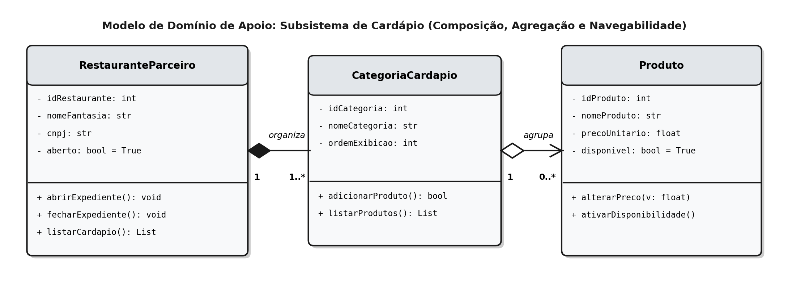
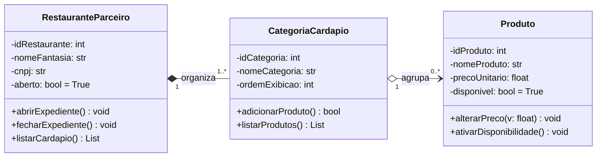
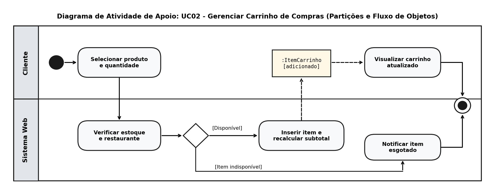
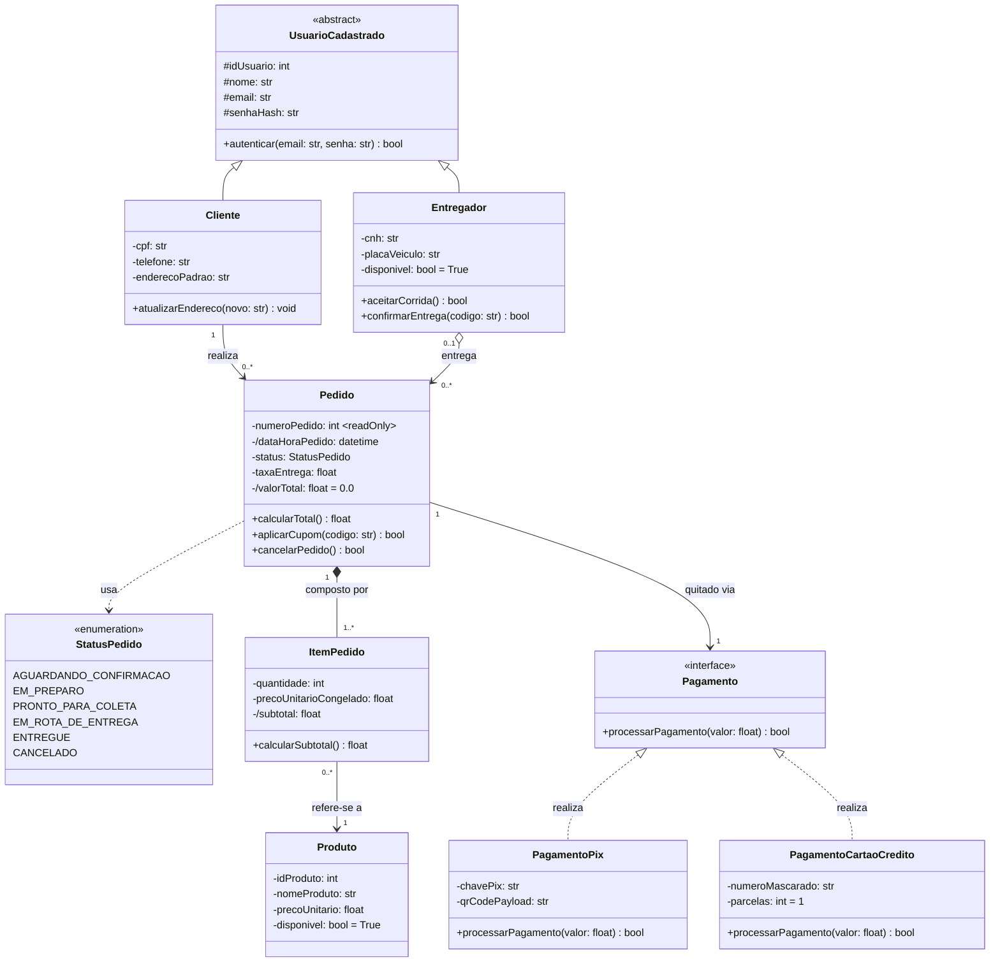
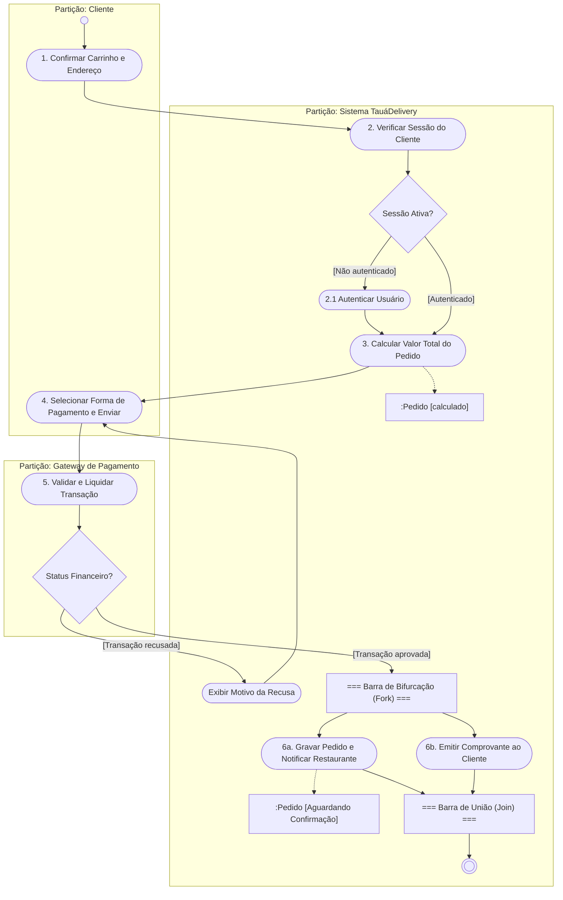

# Atividade Prática: Modelagem Estrutural (Diagrama de Classes) e Comportamental (Diagrama de Atividades)

*   **Disciplina:** Engenharia de Software (Código: TSII.210 / 17.202.9 | Carga Horária: 80h)
*   **Curso:** Técnico em Informática para Internet
*   **Instituição:** Instituto Federal do Ceará (IFCE) - Campus Tauá
*   **Professor:** Reginaldo Pereira Fernandes
*   **Aula 21:** Aprofundamento no Diagrama de Classes e Diagrama de Atividades
*   **Referência Básica:** Capítulos 4 e 10 do livro *UML 2 – Uma abordagem prática* (Gilleanes T. A. Guedes).

---

## 🎯 1. Objetivos

1.  Modelar a estrutura estática de domínio com o **Diagrama de Classes**, aplicando visibilidade, atributos derivados (`/`), multiplicidades, navegabilidade, generalização, agregação ($\lozenge$), composição ($\blacklozenge$), classes associativas/intermediárias, enumerações (`<<enumeration>>`) e realização de interfaces (`<<interface>>`).
2.  Modelar fluxos de controle e de objetos com o **Diagrama de Atividades**, aplicando nós iniciais/finais, nós de ação, nós de decisão com condições de guarda, barras de bifurcação/união (*Fork/Join*), nós de objeto e partições de atividade (*Swimlanes* / Raias).
3.  Integrar o Modelo de Casos de Uso (construído na Aula 20) com o Modelo de Domínio e com o fluxo algorítmico do sistema *TauáDelivery Web*.

---

## 📋 2. Especificação Estrutural e de Fluxo: *TauáDelivery Web*

Dando continuidade ao levantamento de requisitos da plataforma *TauáDelivery Web* iniciado na Aula 20, a equipe de arquitetura levantou as seguintes regras estruturais e de processo para o **Subsistema de Pedidos, Entregas e Pagamentos**:

### 2.1 Regras Estruturais do Domínio (Para o Diagrama de Classes)
*   **Hierarquia de Usuários (`UsuarioCadastrado`, `Cliente` e `Entregador`):**
    *   `UsuarioCadastrado` é uma **classe abstrata** contendo `# idUsuario: int`, `# nome: str`, `# email: str`, `# senhaHash: str` e o método `+ autenticar(email: str, senha: str): bool`.
    *   `Cliente` herda de `UsuarioCadastrado`, adicionando `- cpf: str`, `- telefone: str` e `- enderecoPadrao: str`.
    *   `Entregador` herda de `UsuarioCadastrado`, adicionando `- cnh: str`, `- placaVeiculo: str` e `- disponivel: bool = True`, além dos métodos `+ aceitarCorrida(): bool` e `+ confirmarEntrega(codigo: str): bool`.
*   **Pedido e Itens do Pedido (`Pedido`, `ItemPedido` e `Produto`):**
    *   Um `Cliente` realiza zero ou muitos `Pedido` (`0..*`), e cada `Pedido` pertence obrigatoriamente a um único `Cliente` (`1`).
    *   A classe `Pedido` possui `- numeroPedido: int {readOnly}`, `- /dataHoraPedido: datetime`, `- status: StatusPedido`, `- taxaEntrega: float` e o **atributo derivado** `- /valorTotal: float = 0.0`, além dos métodos `+ calcularTotal(): float`, `+ aplicarCupom(codigo: str): bool` e `+ cancelarPedido(): bool`.
    *   **Enumeração `StatusPedido` (`<<enumeration>>`):** Define os literais `AGUARDANDO_CONFIRMACAO`, `EM_PREPARO`, `PRONTO_PARA_COLETA`, `EM_ROTA_DE_ENTREGA`, `ENTREGUE` e `CANCELADO`.
    *   **Composição Todo-Parte Forte (`Pedido` $\blacklozenge\longrightarrow$ `ItemPedido`):** Um `Pedido` é composto por `1..*` instâncias de `ItemPedido` (`- quantidade: int`, `- precoUnitarioCongelado: float`, `- /subtotal: float`). Se o `Pedido` for destruído, seus `ItemPedido` deixam de existir. Cada `ItemPedido` referencia `1` `Produto` do cardápio (navegabilidade `ItemPedido ---> Produto`).
*   **Alocação de Entrega (Agregação):**
    *   Um `Entregador` pode conduzir `0..*` objetos `Pedido` ao longo do tempo, e um `Pedido` pode ter `0..1` `Entregador` alocado (zero enquanto aguarda aceite, um após ser aceito).
*   **Contrato de Pagamento (`<<interface>> Pagamento`):**
    *   O `Pedido` está associado a `1` forma de pagamento através da interface `<<interface>> Pagamento`, que declara a operação `+ processarPagamento(valor: float): bool`.
    *   As classes concretas `PagamentoPix` (`- chavePix: str`, `- qrCodePayload: str`) e `PagamentoCartaoCredito` (`- numeroMascarado: str`, `- parcelas: int = 1`) **realizam** (implementam) a interface `Pagamento`.

### 2.2 Regras de Processo do Caso de Uso *UC03: Finalizar Pedido* (Para o Diagrama de Atividades)
O fluxo operacional de finalização e despacho do pedido envolve **três raias (partições)**: **Cliente**, **Sistema TauáDelivery** e **Gateway de Pagamento**:
1.  O **Cliente** inicia o fluxo acionando `"Confirmar Carrinho e Endereço"`.
2.  O **Sistema TauáDelivery** executa a ação `"Verificar Sessão do Cliente"`, seguida de um **Nó de Decisão**:
    *   `[Não autenticado]`: executa `"Autenticar Usuário"` e segue adiante;
    *   `[Autenticado]`: segue diretamente para a próxima etapa.
3.  O **Sistema TauáDelivery** executa `"Calcular Valor Total do Pedido"` (gerando/atualizando o nó de objeto `:Pedido [calculado]`).
4.  O **Cliente** executa `"Selecionar Forma de Pagamento e Enviar"`.
5.  O **Gateway de Pagamento** executa `"Validar e Liquidar Transação"`, seguida de um **Nó de Decisão**:
    *   `[Transação recusada]`: o **Sistema TauáDelivery** executa `"Exibir Motivo da Recusa"` e o fluxo retorna para `"Selecionar Forma de Pagamento e Enviar"`;
    *   `[Transação aprovada]`: o fluxo atinge uma **Barra de Bifurcação (*Fork*)** no **Sistema TauáDelivery**, disparando **duas ações em paralelo**:
        *   Ramo paralelo 1: `"Gravar Pedido e Notificar Restaurante"` (atualizando o objeto `:Pedido [Aguardando Confirmação]`);
        *   Ramo paralelo 2: `"Emitir Comprovante para o Cliente"`.
6.  As duas ações paralelas sincronizam-se em uma **Barra de União (*Join*)**, encerrando o processo no **Nó de Final de Atividade**.

---

## 💡 3. Exemplo Resolvido de Apoio: Subsistema de Cardápio e Carrinho

Para guiar a construção dos seus diagramas nas Partes 2 e 3, observe como modelamos o **Subsistema de Cardápio** (Diagrama de Classes) e o **Processo de Gerenciar Carrinho** (Diagrama de Atividades com Partições):

### 3.1 Exemplo de Diagrama de Classes (Subsistema de Cardápio)

No subsistema de cardápio, um `RestauranteParceiro` organiza seu cardápio em uma ou mais instâncias de `CategoriaCardapio` por meio de uma **Composição ($\blacklozenge$)** (uma categoria específica de um restaurante não existe sem ele). Já a `CategoriaCardapio` agrupa zero ou mais instâncias de `Produto` por meio de uma **Agregação ($\lozenge$)** com navegabilidade unilateral:

### 3.2 Exemplo de Diagrama de Atividades com Partições (UC02: Gerenciar Carrinho)

Abaixo é apresentado o Diagrama de Atividades dividido nas raias **Cliente** e **Sistema Web**, demonstrando o Nó Inicial, Nós de Ação, Nó de Decisão com Condições de Guarda (`[Disponível]` vs. `[Item indisponível]`), Fluxo de Objetos (`:ItemCarrinho [adicionado]`) e Nó de Final de Atividade:

---

## 📝 4. Desafios Propostos para os Alunos

### PARTE 1: Análise Conceitual e Fixação (3,0 Pontos)

#### Questão 1.1: Agregação vs. Composição no Domínio de Delivery
1. Qual é a diferença semântica e de ciclo de vida entre os relacionamentos de **Agregação ($\lozenge$)** e **Composição ($\blacklozenge$)** na UML 2?
2. Por que o relacionamento entre `Pedido` e `ItemPedido` deve ser modelado como **Composição**, enquanto o relacionamento entre `ItemPedido` e `Produto` é uma associação simples navegável?

#### Questão 1.2: Classes Associativas e Interfaces
1. Em um relacionamento muitos-para-muitos (`0..*` para `0..*`) entre `Cliente` e `RestauranteParceiro` representando avaliações realizadas, onde devem ser armazenados os atributos `nota: int` e `comentario: str`? Quando devemos usar uma **Classe Associativa** (Fig. 4.13) e quando devemos usar uma **Classe Intermediária** (Fig. 4.14)?
2. Qual é a vantagem arquitetural de associar a classe `Pedido` à interface `<<interface>> Pagamento` (realizada por `PagamentoPix` e `PagamentoCartaoCredito`) em vez de acoplar `Pedido` diretamente a uma classe concreta?

#### Questão 1.3: Controle e Concorrência no Diagrama de Atividades
1. Diferencie o papel de um **Nó de Decisão** (losango) do papel de uma **Barra de Bifurcação (*Fork*)** no Diagrama de Atividades.
2. Qual é a diferença entre o **Nó de Final de Atividade** ($\odot$) e o **Nó de Final de Fluxo** ($\otimes$)?

---

### PARTE 2: Construção do Diagrama de Classes de Domínio (4,0 Pontos)

Com base nas regras da **Seção 2.1**, construa o **Diagrama de Classes completo** para o subsistema de Pedidos e Pagamentos do *TauáDelivery Web* contendo:
1.  A hierarquia de generalização/especialização de `UsuarioCadastrado` (abstrata) com as subclasses `Cliente` e `Entregador`.
2.  As classes `Pedido`, `ItemPedido` e `Produto`, com seus atributos (incluindo visibilidade, atributos derivados com `/` e restrição `{readOnly}`) e operações.
3.  A enumeração `<<enumeration>> StatusPedido` com seus literais.
4.  Os relacionamentos com multiplicidades corretas:
    *   Associação entre `Cliente` (`1`) e `Pedido` (`0..*`);
    *   Composição ($\blacklozenge$) entre `Pedido` (`1`) e `ItemPedido` (`1..*`);
    *   Associação navegável entre `ItemPedido` (`0..*`) e `Produto` (`1`);
    *   Associação/Agregação entre `Entregador` (`0..1`) e `Pedido` (`0..*`).
5.  A interface `<<interface>> Pagamento` associada a `Pedido` e realizada (`- - -|>`) pelas classes `PagamentoPix` e `PagamentoCartaoCredito`.

---

### PARTE 3: Construção do Diagrama de Atividades com Partições (3,0 Pontos)

Com base no roteiro da **Seção 2.2**, construa o **Diagrama de Atividades** para o processo **UC03 - Finalizar Pedido**:
1.  Estruture as **3 Partições (Raias)**: `Cliente`, `Sistema TauáDelivery` e `Gateway de Pagamento`.
2.  Posicione corretamente o **Nó Inicial**, os **Nós de Ação** em suas respectivas raias e os **Fluxos de Controle**.
3.  Represente os dois **Nós de Decisão** com suas **Condições de Guarda** entre colchetes (`[Autenticado]` / `[Não autenticado]` e `[Transação aprovada]` / `[Transação recusada]`).
4.  Represente o **Nó de Objeto** `:Pedido` com seu estado entre colchetes.
5.  Represente o paralelismo pós-aprovação utilizando a **Barra de Bifurcação (*Fork*)** e a **Barra de União (*Join*)** antes do **Nó de Final de Atividade**.

---

## 📊 5. Rubrica de Avaliação

| Critério | Peso | Atendimento Pleno (100%) | Atendimento Parcial (60%) | Não Atendido (0-30%) |
| :--- | :---: | :--- | :--- | :--- |
| **Análise Conceitual (Parte 1)** | 30% | Explica com precisão ciclo de vida em agregação/composição, classe associativa vs. intermediária, realização de interfaces e nós de atividade. | Explicações corretas, porém superficiais ou sem distinção entre classe associativa e intermediária. | Confunde agregação com herança ou decisão com bifurcação paralela. |
| **Diagrama de Classes (Parte 2)** | 40% | Representa todas as classes, visibilidades, atributos derivados (`/`), herança, composição ($\blacklozenge$), multiplicidades e realização de interface (`<<interface>>`). | Omissão pontual de multiplicidades, visibilidades ou troca entre losango vazio e preenchido. | Diagrama sem relacionamentos tipados ou sem distinção entre classes e interfaces. |
| **Diagrama de Atividades (Parte 3)** | 30% | Diagrama estruturado em 3 raias, com guardas entre colchetes, retorno de recusa de pagamento, Fork/Join paralelo e nó de objeto `:Pedido`. | Fluxo sequencial correto, mas sem partições (raias) ou sem sincronização Fork/Join. | Fluxo incompleto, sem condições de guarda ou confundindo casos de uso com ações. |

---

## 🔑 6. Gabarito Comentado

### Respostas da Parte 1:
*   **1.1.1:** Na **Agregação ($\lozenge$)**, há uma relação Todo-Parte fraca: as partes complementam o todo, mas possuem ciclo de vida independente (se o objeto-todo for excluído, os objetos-parte continuam existindo e podem ser compartilhados). Na **Composição ($\blacklozenge$)**, há uma relação Todo-Parte forte e exclusiva: uma instância-parte pertence a um único objeto-todo por vez e seu ciclo de vida é estritamente acoplado (a destruição do todo implica a destruição automática de suas partes).
*   **1.1.2:** Um `ItemPedido` (ex.: "2x Pizza Calabresa a R$ 45,00 no Pedido #104") não faz sentido existir fora do `Pedido #104`; se o pedido for removido, suas linhas de item também são excluídas (**Composição**). Já o `Produto` ("Pizza Calabresa" no catálogo) continua existindo no cardápio independentemente de qualquer pedido (**Associação navegável**).
*   **1.2.1:** Os atributos `nota` e `comentario` pertencem ao vínculo entre `Cliente` e `RestauranteParceiro`. Se um cliente pudesse avaliar cada restaurante **apenas uma única vez**, usaríamos uma **Classe Associativa** ligada por linha tracejada à associação (Fig. 4.13). Como no delivery um cliente pode fazer vários pedidos e avaliar o mesmo restaurante **múltiplas vezes** em datas distintas, deve-se utilizar uma **Classe Intermediária** (`Avaliacao`) com multiplicidades `1` para `0..*` em ambos os lados (Fig. 4.14).
*   **1.2.2:** Desacoplamento e extensibilidade (Princípio Aberto-Fechado / Polimorfismo): a classe `Pedido` invoca apenas `+processarPagamento(valor)` na interface `Pagamento` sem precisar conhecer detalhes internos de PIX, Cartão ou Boleto. Novas formas de pagamento podem ser adicionadas sem alterar uma única linha da classe `Pedido`.
*   **1.3.1:** O **Nó de Decisão** (losango) realiza um desvio condicional mutuamente exclusivo (*OU*): apenas **um** dos fluxos de saída será percorrido conforme a condição de guarda verdadeira. Já a **Barra de Bifurcação (*Fork*)** divide o fluxo em dois ou mais caminhos **concorrentes/paralelos** (*E*): **todos** os fluxos de saída são executados simultaneamente.
*   **1.3.2:** O **Nó de Final de Atividade** ($\odot$, círculo com ponto cheio interno) encerra imediatamente toda a atividade global e todos os fluxos ativos. O **Nó de Final de Fluxo** ($\otimes$, círculo com um X interno) encerra apenas o ramo/fluxo concorrente específico que chegou até ele, mantendo os demais ramos paralelos da atividade em execução.

---

### Gabarito da Parte 2: Diagrama de Classes do Domínio (*TauáDelivery Web*)

---

### Gabarito da Parte 3: Diagrama de Atividades com Partições (*UC03: Finalizar Pedido*)

