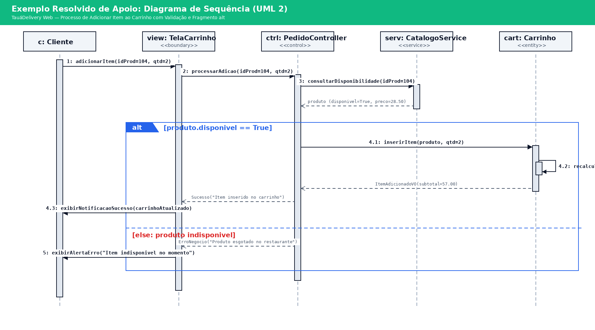
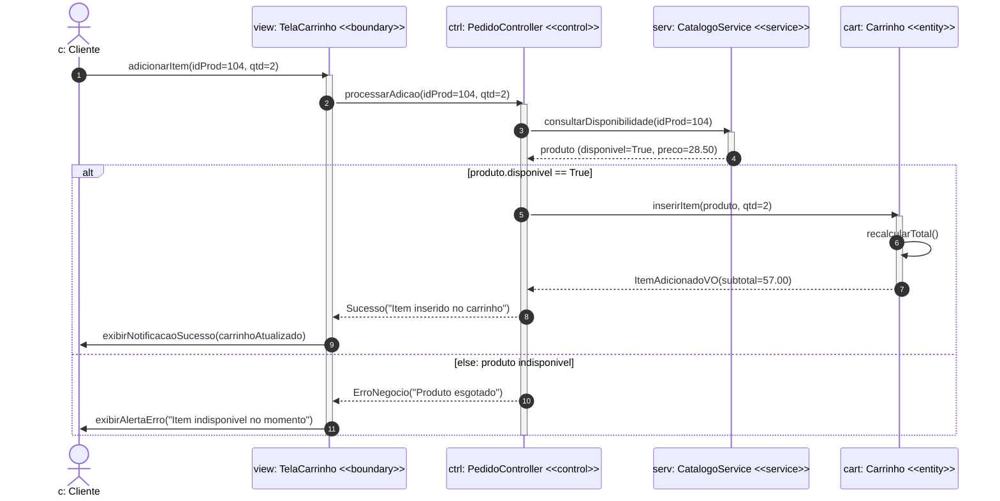
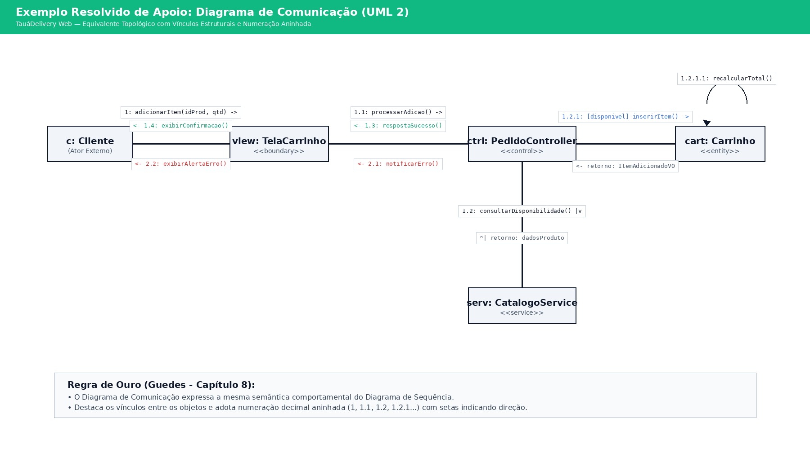
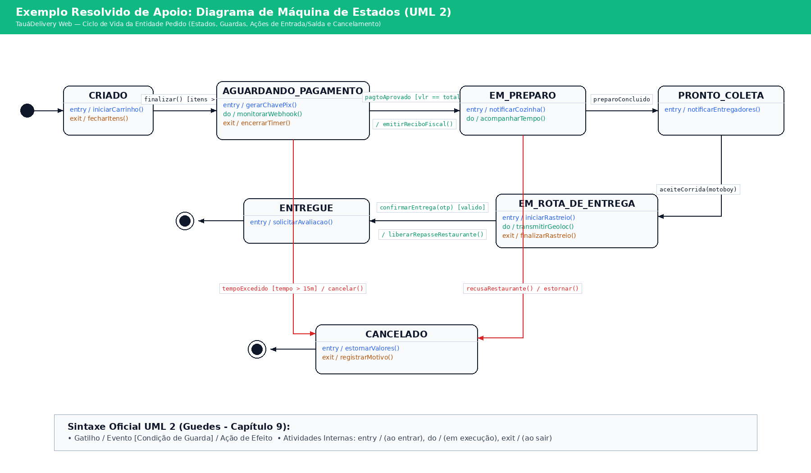
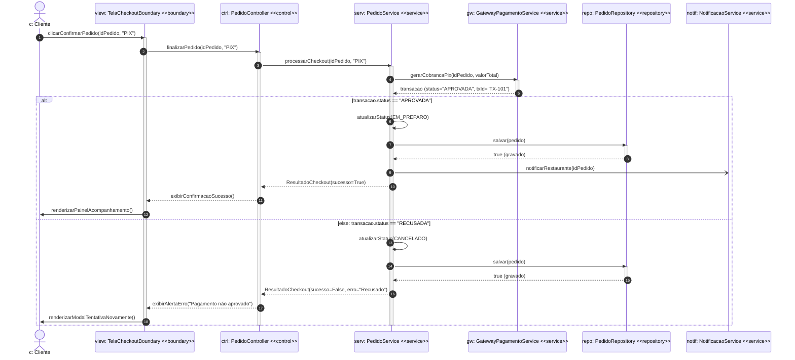

# Atividade Prática: Diagramas de Interação (Sequência e Comunicação) e Diagrama de Máquina de Estados

*   **Disciplina:** Engenharia de Software (Código: TSII.210 / 17.202.9 | Carga Horária: 80h)
*   **Curso:** Técnico em Informática para Internet
*   **Instituição:** Instituto Federal do Ceará (IFCE) - Campus Tauá
*   **Professor:** Reginaldo Pereira Fernandes
*   **Aula 22:** Diagramas de Interação (Sequência e Comunicação) e Diagrama de Máquina de Estados
*   **Referência Básica:** Capítulos 7, 8 e 9 do livro *UML 2 – Uma abordagem prática* (Gilleanes T. A. Guedes).

---

## 🎯 1. Objetivos de Aprendizagem

1.  Modelar a troca dinâmica de mensagens ao longo do tempo utilizando o **Diagrama de Sequência** (Capítulo 7), aplicando linhas de vida (*lifelines*), focos de controle, tipos de mensagens (síncronas, assíncronas, retornos e construtoras) e Fragmentos Combinados (`alt`, `opt`, `loop`).
2.  Representar a mesma colaboração comportamental sob a perspectiva topológica de rede através do **Diagrama de Comunicação** (Capítulo 8), utilizando vínculos estruturais (*links*), direção de estímulos e numeração decimal aninhada (`1`, `1.1`, `1.2`, `1.2.1`).
3.  Modelar o ciclo de vida reativo de uma entidade central com o **Diagrama de Máquina de Estados** (Capítulo 9), especificando eventos de disparo, condições de guarda booleanas `[guarda]`, ações de efeito `/ação`, atividades internas (`entry /`, `do /`, `exit /`) e pseudoestados.
4.  Integrar a arquitetura em camadas MVC/ECB (`<<boundary>>`, `<<control>>`, `<<entity>>`) com a persistência de dados (*Repository / DAO*), consolidando a modelagem do sistema *TauáDelivery Web*.

---

## 📋 2. Especificação do Caso de Uso: *TauáDelivery Web*

Dando continuidade aos requisitos do sistema *TauáDelivery Web* modelados nas Aulas 20 e 21, a equipe de engenharia detalhou o fluxo de execução do **Caso de Uso *UC03: Finalizar Pedido e Processar Pagamento*** e o ciclo de vida da entidade `Pedido`.

### 2.1 Especificação da Interação (*UC03: Finalizar Pedido e Processar Pagamento*)

O processo de finalização de um pedido envolve os seguintes participantes e camadas:
*   **Ator Externo:** `c: Cliente` (usuário final autenticado no aplicativo web).
*   **Camada de Fronteira / Apresentação:** `view: TelaCheckoutBoundary` (`<<boundary>>`).
*   **Camada de Controle e Aplicação:** `ctrl: PedidoController` (`<<control>>`).
*   **Camada de Negócio e Serviços:** `serv: PedidoService` (`<<service>>`).
*   **Serviço Externo Integrado:** `gw: GatewayPagamentoService` (`<<service>>` que integra a API PIX do Banco Central).
*   **Camada de Persistência:** `repo: PedidoRepository` (`<<repository>>` / *DAO*).
*   **Camada de Mensageria:** `notif: NotificacaoService` (`<<service>>` assíncrono).

#### Fluxo Passo a Passo do UC03:
1.  O `Cliente` aciona o botão `"Submeter Pedido"` na interface (`TelaCheckoutBoundary`), informando o ID do pedido e a modalidade PIX.
2.  A `TelaCheckoutBoundary` invoca de forma síncrona `finalizarPedido(idPedido, formaPagamento="PIX")` no `PedidoController`.
3.  O `PedidoController` delega a regra de negócio chamando `processarCheckout(idPedido, "PIX")` no `PedidoService`.
4.  O `PedidoService` recupera a instância do pedido ativa e dispara a solicitação de débito chamando síncronamente `gerarCobrancaPix(idPedido, valorTotal)` no `GatewayPagamentoService`.
5.  O `GatewayPagamentoService` retorna os dados da transação contendo o status (`APROVADA` ou `RECUSADA`).
6.  **Fragmento Combinado `alt`:**
    *   **Ramo `[transacao.status == APROVADA]`:**
        *   O `PedidoService` invoca `atualizarStatus(StatusPedido.EM_PREPARO)` na entidade `pedido`.
        *   O `PedidoService` chama `salvar(pedido)` no `PedidoRepository` para persistir o novo estado no banco de dados relacional. O repositório responde confirmando a gravação.
        *   O `PedidoService` envia uma **mensagem assíncrona** `notificarRestaurante(idPedido)` para o `NotificacaoService` (para que o painel KDS da cozinha imprima a comanda sem travar a requisição web).
        *   O `PedidoService` retorna `CheckoutResult(sucesso=True)` ao `PedidoController`, que por sua vez responde para a `TelaCheckoutBoundary`.
        *   A `TelaCheckoutBoundary` exibe a tela de confirmação e inicia o painel de rastreamento para o `Cliente`.
    *   **Ramo `[else: transacao.status == RECUSADA]`:**
        *   O `PedidoService` invoca `atualizarStatus(StatusPedido.CANCELADO)` na entidade `pedido`.
        *   O `PedidoService` persiste o cancelamento via `PedidoRepository.salvar(pedido)`.
        *   O `PedidoService` retorna resposta de falha com a mensagem de erro do gateway.
        *   A `TelaCheckoutBoundary` renderiza modal de alerta informando `"Pagamento não autorizado"` e orientando o cliente a tentar novamente.

---

### 2.2 Especificação do Ciclo de Vida da Entidade `Pedido`

A entidade central `Pedido` atravessa os seguintes estados durante seu ciclo de vida:
1.  **Estado Inicial:** O ciclo começa com a criação do carrinho.
2.  **Estado `CRIADO`:** O cliente adiciona ou remove itens do carrinho.
    *   *Atividade de Entrada (`entry /`):* `inicializarCarrinho()`.
    *   *Transição:* Quando o cliente clica em avançar para pagamento, ocorre o evento `checkoutIniciado [itens > 0] / congelarPrecos()` levando ao estado `AGUARDANDO_PAGAMENTO`.
3.  **Estado `AGUARDANDO_PAGAMENTO`:** O sistema aguarda a compensação do PIX ou a aprovação do cartão.
    *   *Atividade de Entrada (`entry /`):* `gerarQrCodePix()`.
    *   *Atividade de Execução Contínua (`do /`):* `monitorarWebhookGateway()`.
    *   *Atividade de Saída (`exit /`):* `encerrarTimerExpiracao()`.
    *   *Transições:*
        *   Se o pagamento for liquidado com sucesso: `pagamentoConfirmado [valorPago == total] / emitirReciboFiscal()` leva para o estado `EM_PREPARO`.
        *   Se o cliente desistir ou estourar o tempo limite de 15 minutos: `timeoutExcedido [tempo > 15min] / cancelarReserva()` ou `canceladoPeloUsuario()` leva ao estado `CANCELADO`.
4.  **Estado `EM_PREPARO`:** A cozinha do restaurante prepara os pratos do pedido.
    *   *Atividade de Entrada (`entry /`):* `imprimirComandaKds()`.
    *   *Transições:*
        *   Quando o chef finaliza a refeição: evento `preparoConcluido() / empacotarItens()` leva ao estado `PRONTO_PARA_COLETA`.
        *   Caso ocorra falta de insumo: evento `faltaIngrediente() / notificarEstorno()` leva ao estado `CANCELADO`.
5.  **Estado `PRONTO_PARA_COLETA`:** O pacote está no balcão aguardando um entregador parceiro.
    *   *Atividade de Entrada (`entry /`):* `dispararChamadaEntregadores()`.
    *   *Transição:* Quando um motoboy aceita a entrega no app: evento `corridaAceita(entregador) / vincularEntregador()` leva ao estado `EM_ROTA_DE_ENTREGA`.
6.  **Estado `EM_ROTA_DE_ENTREGA`:** O entregador está em trânsito com o pedido até a residência do cliente.
    *   *Atividade de Execução Contínua (`do /`):* `transmitirGeolocalizacaoGps()`.
    *   *Atividade de Saída (`exit /`):* `finalizarRastreamento()`.
    *   *Transição:* Ao chegar ao destino, o motoboy coleta o código de segurança do cliente: evento `informarOtp(codigo) [codigo == pedido.otp] / liberarRepasseFinanceiro()` leva ao estado `ENTREGUE`.
7.  **Estado `ENTREGUE`:** O pedido foi concluído com sucesso.
    *   *Atividade de Entrada (`entry /`):* `enviarPesquisaSatisfacao()`.
    *   *Transição Final:* Segue para o **Estado Final ($\odot$)**.
8.  **Estado `CANCELADO`:** O pedido foi interrompido.
    *   *Atividade de Entrada (`entry /`):* `estornarCobrancaELiberarEstoque()`.
    *   *Transição Final:* Segue para o **Estado Final ($\odot$)**.

---

## 💡 3. Exemplos Resolvidos de Apoio

Para orientar a resolução das Partes 2, 3 e 4, observe os diagramas resolvidos abaixo para o subsistema de adição de itens ao carrinho:

### 3.1 Exemplo de Apoio: Diagrama de Sequência (Adicionar Item)





### 3.2 Exemplo de Apoio: Diagrama de Comunicação (Adicionar Item)



*Observe a numeração decimal aninhada (`1`, `1.1`, `1.2`, `1.2.1`, `1.2.1.1`), onde cada ponto decimal denota a chamada filha disparada a partir do foco de controle da chamada mãe.*

### 3.3 Exemplo de Apoio: Diagrama de Máquina de Estados (Ciclo de Vida do Pedido)



```mermaid
stateDiagram-v2
    [*] --> CRIADO
    
    CRIADO --> AGUARDANDO_PAGAMENTO: finalizar() [itens > 0] / fecharItens()
    
    state AGUARDANDO_PAGAMENTO {
        entry: gerarChavePix()
        do: monitorarWebhook()
        exit: encerrarTimer()
    }
    
    AGUARDANDO_PAGAMENTO --> EM_PREPARO: pagtoAprovado [vlr == total] / emitirReciboFiscal()
    AGUARDANDO_PAGAMENTO --> CANCELADO: tempoExcedido [tempo > 15m] / cancelar()
    
    state EM_PREPARO {
        entry: notificarCozinha()
        do: acompanharTempo()
    }
    
    EM_PREPARO --> PRONTO_COLETA: preparoConcluido / empacotar()
    EM_PREPARO --> CANCELADO: recusaRestaurante() / estornar()
    
    state PRONTO_COLETA {
        entry: notificarEntregadores()
    }
    
    PRONTO_COLETA --> EM_ROTA_DE_ENTREGA: aceiteCorrida(motoboy) / vincular()
    
    state EM_ROTA_DE_ENTREGA {
        entry: iniciarRastreio()
        do: transmitirGeoloc()
        exit: finalizarRastreio()
    }
    
    EM_ROTA_DE_ENTREGA --> ENTREGUE: confirmarEntrega(otp) [valido] / repassarValor()
    
    state ENTREGUE {
        entry: solicitarAvaliacao()
    }
    
    state CANCELADO {
        entry: estornarValores()
        exit: registrarMotivo()
    }
    
    ENTREGUE --> [*]
    CANCELADO --> [*]
```

---

## ✏️ 4. Atividades Práticas Propostas

### PARTE 1: Questões Conceituais e Analíticas (Peso: 2,5 pontos)
Responda de forma sucinta e justificada:
1.  **Diferenciação Semântica (Sequência vs. Comunicação):** Sob qual justificativa técnica um arquiteto de software deve preferir o Diagrama de Sequência em vez do Diagrama de Comunicação para documentar um caso de uso complexo como o *UC03: Finalizar Pedido*? E em qual cenário o Diagrama de Comunicação seria superior?
2.  **Fragmentos Combinados (`alt` vs. `opt`):** No Diagrama de Sequência da UML 2, por que não se deve utilizar dois fragmentos `opt` consecutivos quando se deseja representar uma validação de pagamento aprovado versus recusado? Qual operador de interação é o recomendado e por quê?
3.  **Máquina de Estados: Atividades Internas vs. Transições:** Explique a diferença semântica entre:
    *   Uma atividade interna `exit / encerrarTimer()` de um estado;
    *   Uma ação de efeito executada sobre a flecha de transição `/ encerrarTimer()`.
    Em que momento exato cada uma delas é disparada?
4.  **Pseudoestados de Decisão (Escolha vs. Junção):** No Capítulo 9 de Guedes, diferencia-se o *Pseudoestado de Escolha (Choice)* do *Pseudoestado de Junção (Junction)*. Qual deles avalia as guardas dinamicamente durante a execução e qual realiza avaliação estática preliminar antes de transitar?

---

### PARTE 2: Diagrama de Sequência do UC03 (Peso: 2,5 pontos)
Com base na especificação da Seção 2.1, elabore o **Diagrama de Sequência completo** do caso de uso *UC03: Finalizar Pedido e Processar Pagamento*.
*Requisitos Obrigatórios:*
*   Incluir todas as 7 linhas de vida com seus estereótipos corretos (`c: Cliente`, `view: TelaCheckoutBoundary`, `ctrl: PedidoController`, `serv: PedidoService`, `gw: GatewayPagamentoService`, `repo: PedidoRepository`, `notif: NotificacaoService`).
*   Representar o envio da notificação à cozinha através de uma **mensagem assíncrona** (flecha aberta $\rightarrow$).
*   Modelar a ramificação condicional do resultado do gateway utilizando o **Fragmento Combinado `alt`** com os operandos `[transacao.status == APROVADA]` e `[else: recusada]`.
*   Indicar corretamente as ativações (*focos de controle*) e as respostas tracejadas ($\dashrightarrow$).

---

### PARTE 3: Diagrama de Comunicação do UC03 (Peso: 2,5 pontos)
Converta a colaboração do *UC03* em um **Diagrama de Comunicação**.
*Requisitos Obrigatórios:*
*   Representar os vínculos estruturais (*links*) entre as classes/instâncias sem cruzar linhas desnecessariamente.
*   Adotar a numeração decimal sequencial hierárquica oficial (`1`, `1.1`, `1.2`, `1.2.1`, `1.2.2`, `1.2.3`, etc.).
*   Indicar a condição de guarda `[status == APROVADA]` e `[status == RECUSADA]` nas mensagens derivadas do gateway.

---

### PARTE 4: Diagrama de Máquina de Estados da Entidade `Pedido` (Peso: 2,5 pontos)
Com base na especificação da Seção 2.2, construa o **Diagrama de Máquina de Estados da classe `Pedido`**.
*Requisitos Obrigatórios:*
*   Representar os estados: `CRIADO`, `AGUARDANDO_PAGAMENTO`, `EM_PREPARO`, `PRONTO_PARA_COLETA`, `EM_ROTA_DE_ENTREGA`, `ENTREGUE` e `CANCELADO`.
*   Inserir o Estado Inicial ($\bullet$) e os Estados Finais ($\odot$).
*   Declarar as atividades internas `entry /`, `do /` e `exit /` nos estados que as exigem.
*   Escrever a especificação formal nas flechas de transição: `evento [guarda] / acao`.

---

## 📊 5. Rubrica de Avaliação

| Critério | Excelente (100%) | Regular (70%) | Insuficiente (< 50%) |
| :--- | :--- | :--- | :--- |
| **Parte 1: Domínio Conceitual (2,5 pts)** | Respostas tecnicamente impecáveis citando a semântica da UML 2 e o livro de Guedes. | Responde às perguntas mas comete pequenas imprecisões conceituais. | Erra conceitos fundamentais (ex.: confunde síncrona com assíncrona). |
| **Parte 2: Diagrama de Sequência (2,5 pts)** | Diagrama completo com todas as 7 lifelines, uso correto do operador `alt`, mensagens assíncronas e retornos. | Faltam ativações ou usa notação incorreta no operador de fragmento. | Diagrama incompleto, omite o gateway ou inverte o sentido de mensagens. |
| **Parte 3: Diagrama de Comunicação (2,5 pts)** | Numeração sequencial aninhada perfeita (`1.2.1`, `1.2.2`) e vínculos estruturais limpos. | Numeração plana sem expressar aninhamento ou omite condições de guarda. | Desenho confuso sem representação de vínculos válidos. |
| **Parte 4: Máquina de Estados (2,5 pts)** | Todos os estados presentes com sintaxe canônica `evento [guarda] / acao` e atividades `entry`/`do`/`exit`. | Ocorre omissão de atividades internas ou condições de guarda incompletas. | Confunde máquina de estados com fluxograma ou diagrama de atividades. |

---

## 🎯 6. Gabarito Comentado e Soluções Esperadas

### Solução da Parte 1 (Conceitual)
1.  **Sequência vs. Comunicação:** O Diagrama de Sequência é superior para o *UC03* porque sua linha do tempo vertical enfatiza a **ordem cronológica exata dos passos**, o tempo de vida das ativações e o desvio condicional (`alt`). Já o Diagrama de Comunicação seria preferível em revisões arquiteturais focadas na **topologia de acoplamento**, permitindo verificar visualmente se alguma classe central virou um *God Object* com excesso de conexões estruturais.
2.  **Fragmento `alt` vs. `opt`:** O operador `opt` modela comportamentos opcionais sem alternativa `else`. Dois fragmentos `opt` consecutivos são formalmente desacoplados e poderiam, em teoria de especificação, executar ambos se não houvesse garantia formal. O operador `alt` (*alternatives*) é a construção correta porque define operandos mutuamente exclusivos onde um e apenas um dos ramos pode ser percorrido.
3.  **Atividades `exit` vs. Ações de Efeito:** A atividade interna `exit / encerrarTimer()` é executada automaticamente **sempre que o objeto abandona aquele estado**, qualquer que seja a transição disparada. Já uma ação sobre a transição `/ encerrarTimer()` é executada **apenas se aquela transição específica for disparada**.
4.  **Choice vs. Junction:** O **Pseudoestado de Escolha (*Choice* - $\lozenge$)** avalia as condições de guarda dinamicamente no instante em que o fluxo o atinge (tempo de execução). Já o **Pseudoestado de Junção (*Junction* - $\bullet$)** avalia estaticamente todas as condições de guarda antes de iniciar o disparo da transição composta.

---

### Solução da Parte 2 (Diagrama de Sequência em Mermaid)



---

### Solução da Parte 3 (Diagrama de Comunicação - Estrutura de Vínculos)

No Diagrama de Comunicação, os objetos são dispostos em rede sobre os seguintes vínculos:
*   `[c: Cliente]` --- `[view: TelaCheckoutBoundary]`
    *   `1: clicarConfirmarPedido() ->`
    *   `<- 1.2.4: renderizarPainelAcompanhamento()`
*   `[view: TelaCheckoutBoundary]` --- `[ctrl: PedidoController]`
    *   `1.1: finalizarPedido() ->`
    *   `<- 1.2.3: exibirConfirmacaoSucesso()`
*   `[ctrl: PedidoController]` --- `[serv: PedidoService]`
    *   `1.2: processarCheckout() ->`
    *   `<- 1.2.2: retornoResultadoCheckout()`
*   `[serv: PedidoService]` --- `[gw: GatewayPagamentoService]`
    *   `1.2.1: gerarCobrancaPix() ->`
    *   `<- retorno: dadosTransacao`
*   `[serv: PedidoService]` --- `[repo: PedidoRepository]`
    *   `1.2.1.1: [status == APROVADA] salvar(pedido) ->`
*   `[serv: PedidoService]` --- `[notif: NotificacaoService]`
    *   `1.2.1.2: [status == APROVADA] notificarRestaurante() ->`

---

### Solução da Parte 4 (Diagrama de Máquina de Estados em Mermaid)

```mermaid
stateDiagram-v2
    [*] --> CRIADO: instanciar()
    
    state CRIADO {
        entry: inicializarCarrinho()
    }
    
    CRIADO --> AGUARDANDO_PAGAMENTO: checkoutIniciado [itens > 0] / congelarPrecos()
    
    state AGUARDANDO_PAGAMENTO {
        entry: gerarQrCodePix()
        do: monitorarWebhookGateway()
        exit: encerrarTimerExpiracao()
    }
    
    AGUARDANDO_PAGAMENTO --> EM_PREPARO: pagamentoConfirmado [valorPago == total] / emitirReciboFiscal()
    AGUARDANDO_PAGAMENTO --> CANCELADO: timeoutExcedido [tempo > 15min] / cancelarReserva()
    AGUARDANDO_PAGAMENTO --> CANCELADO: cancelarPeloUsuario() / liberarEstoque()
    
    state EM_PREPARO {
        entry: imprimirComandaKds()
    }
    
    EM_PREPARO --> PRONTO_PARA_COLETA: preparoConcluido() / empacotarItens()
    EM_PREPARO --> CANCELADO: faltaIngrediente() / notificarEstorno()
    
    state PRONTO_PARA_COLETA {
        entry: dispararChamadaEntregadores()
    }
    
    PRONTO_PARA_COLETA --> EM_ROTA_DE_ENTREGA: corridaAceita(entregador) / vincularEntregador()
    
    state EM_ROTA_DE_ENTREGA {
        do: transmitirGeolocalizacaoGps()
        exit: finalizarRastreamento()
    }
    
    EM_ROTA_DE_ENTREGA --> ENTREGUE: informarOtp(codigo) [codigo == pedido.otp] / liberarRepasseFinanceiro()
    
    state ENTREGUE {
        entry: enviarPesquisaSatisfacao()
    }
    
    state CANCELADO {
        entry: estornarCobrancaELiberarEstoque()
    }
    
    ENTREGUE --> [*]
    CANCELADO --> [*]
```
