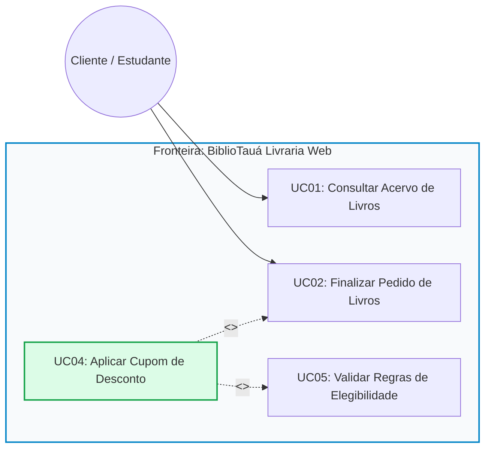
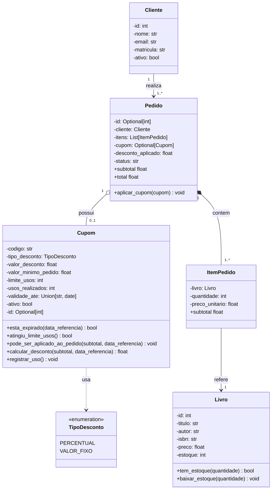

# Guia do Desenvolvedor: Sprint 04 — BiblioTauá (Encontro 1 / Aula 24)
## Casos de Uso, Diagrama de Classes, Arquitetura do Projeto e Início da Codificação

---

## 🎙️ 1. Fala de Abertura da Liderança Técnica (Tech Lead)

> **De:** Aline Mendes (Tech Lead — Equipe BiblioTauá)  
> **Para:** Equipe de Engenharia de Software  
> **Assunto:** Início da Sprint 04 — Módulo de Cupons e Políticas Promocionais  
>
> *"Olá, time de desenvolvimento do **BiblioTauá**! Sejam bem-vindos à Reunião de Planejamento da **Sprint 04**.*
>
> *Nosso sistema de livraria universitária já opera com sucesso nas vendas básicas do acervo didático (versão v0.3.0). Temos catálogo de livros, controle de estoque físico, cadastro de estudantes/clientes, carrinho de compras e banco SQLite funcionando perfeitamente.*
>
> *Para a próxima Feira do Livro do IFCE Campus Tauá, a diretoria acadêmica encomendou uma funcionalidade essencial: concessão de cupons de desconto aos discentes e servidores. Distribuímos as frentes de trabalho:*
>
> * 🖥️ **Mariana (Front-end Web / UI):** *Interface do carrinho no navegador.*
> * 💳 **Lucas (Back-end / Pagamentos):** *Integração com gateway bancário (PIX) para emitir cobrança do valor líquido.*
> * ⚙️ **VOCÊ (Desenvolvedor Júnior / Engenheiro de Software):** *Ficará com o coração do sistema: a **`TASK-204: Motor de Validação e Aplicação de Cupons de Desconto no Checkout`**.*
> * 🧪 **Beatriz (QA & DevOps):** *Acompanhará os testes de regressão e homologação.*
>
> *Atenção ao ritmo da equipe: hoje mesmo vamos compreender o Diagrama de Casos de Uso, a DUC e o Diagrama de Classes, e **já iniciaremos a implementação em Python** criando as exceções de domínio e a entidade `Cupom`!"*

---

## 📌 2. O Ticket da Sua Sprint: `TASK-204`

| Campo | Detalhes do Chamado |
| :--- | :--- |
| **Identificador:** | `TASK-204` |
| **Título:** | Implementação do Motor de Validação e Aplicação de Cupons de Desconto no Checkout de Livros |
| **Responsável:** | Discente (Desenvolvedor de Software) |
| **Prioridade:** | Alta (Bloqueante para o fechamento da Sprint 04) |
| **Estimativa:** | 4 Encontros de Trabalho (8 Horas-Aula) |
| **Branch Git:** | `feature/task-204-motor-cupons` |
| **Metas de Hoje:** | Diagramas UC + Classes $\rightarrow$ Arquitetura $\rightarrow$ Implementação de `exceptions.py` e `models/cupom.py` |

---

## 📐 3. Diagramas de Engenharia de Software (UML 2)

### 3.1 Diagrama de Casos de Uso (UML 2)



*   **$\ll$extend$\gg$ (Extensão):** O caso de uso `UC04: Aplicar Cupom de Desconto` estende opcionalmente o checkout em `UC02: Finalizar Pedido de Livros`. O cliente só insere o código promocional se desejar.
*   **$\ll$include$\gg$ (Inclusão):** Ao acionar `UC04`, o sistema executa compulsoriamente `UC05: Validar Regras de Elegibilidade`, averiguando validade, limite de usos e valor mínimo.

---

### 3.2 Documentação do Caso de Uso (DUC UC04)

*   **Identificador:** `UC04 -- Aplicar Cupom de Desconto`
*   **Ator Primário:** `Cliente / Discente`
*   **Pré-condições:** Carrinho não vazio e subtotal $> 0$.
*   **Pós-condições:** Desconto calculado e total do pedido atualizado.
*   **Fluxo Principal:** 
    1. O cliente informa o código alfanumérico do cupom na tela de checkout.
    2. O sistema recupera os parâmetros do cupom e valida as regras de negócio.
    3. O sistema calcula o valor do desconto (respeitando o teto do subtotal).
    4. O sistema atualiza o subtotal e o total a pagar.
*   **Fluxos Alternativos:**
    *   **FA01 (Desconto Percentual):** $\text{desconto} = \text{subtotal} \times (\text{valor\_desconto} / 100)$.
    *   **FA02 (Desconto em Valor Fixo):** $\text{desconto} = \min(\text{valor\_desconto}, \text{subtotal})$.
*   **Fluxos de Exceção (Mapeamento Direto em Código Python):**
    *   **FE01 (Cupom Inexistente ou Inativo):** Lança `CupomInexistenteError` ou `CupomInativoError`.
    *   **FE02 (Validade Ultrapassada):** Lança `CupomExpiradoError`.
    *   **FE03 (Cota de Usos Esgotada):** Lança `CupomEsgotadoError`.
    *   **FE04 (Subtotal Inferior ao Mínimo Exigido):** Lança `ValorMinimoNaoAtingidoError`.

---

### 3.3 Diagrama de Classes de Domínio (UML 2)



---

## 📂 4. Mapa da Arquitetura do Projeto: Pré-existente vs. TASK-204

### 4.1 Por que o repositório da Aula 24 tem mais arquivos do que o apresentado nos slides?

Em um ambiente profissional de desenvolvimento de software em equipe:
1. **Você nunca começa do zero a cada nova Sprint:** O sistema **BiblioTauá Livraria Web** já passou pelas Sprints 01, 02 e 03 (versão v0.3.0), nas quais foram construídos o catálogo de livros, controle de estoque físico, cadastro de clientes e fechamento básico de pedidos no SQLite.
2. **Integridade de Módulos em Python:** Um pacote Python (`bibliotaua`) requer que suas dependências e relações estruturais existam para que os imports funcionem (`from bibliotaua.models import ...`). Sem os arquivos pré-existentes, o projeto acusaria `ModuleNotFoundError`.
3. **Foco Pedagógico:** Nos slides, o professor foca cirurgicamente no **conteúdo novo da aula de hoje** (`exceptions.py` e `models/cupom.py`), enquanto o repositório mantém a infraestrutura completa para você poder rodar, testar e integrar o código em um cenário de software real.

### 4.2 Matriz de Responsabilidade dos Arquivos

| Arquivo | Camada / Papel | Origem | Elementos e Funções Principais |
| :--- | :--- | :--- | :--- |
| `bibliotaua/database.py` | Infraestrutura / Dados | **Pré-existente (v0.3.0)** | Criação da conexão SQLite (`get_connection`) e execução dos scripts DDL para criação das tabelas `clientes`, `livros`, `pedidos` e `itens_pedido`. Na Aula 25 receberá a tabela `cupons`. |
| `bibliotaua/models/cliente.py` | Domínio / Entidade | **Pré-existente (v0.3.0)** | Classe `@dataclass Cliente`: representa o cliente/estudante (`id`, `nome`, `email`, `matricula`, `ativo`). |
| `bibliotaua/models/livro.py` | Domínio / Entidade | **Pré-existente (v0.3.0)** | Classe `@dataclass Livro`: catálogo de livros (`id`, `titulo`, `autor`, `isbn`, `preco`, `estoque`). Métodos de regra: `tem_estoque(qtd)`, `baixar_estoque(qtd)`. |
| `bibliotaua/models/item_pedido.py` | Domínio / Item Associativo | **Pré-existente (v0.3.0)** | Classe `@dataclass ItemPedido`: linha de um pedido (`livro`, `quantidade`, `preco_unitario`). Propriedade calculada `subtotal = quantidade * preco_unitario`. |
| `bibliotaua/models/pedido.py` | Domínio / Aggregate Root | **Pré-existente (v0.3.0)** | Classe `@dataclass Pedido`: fechamento da compra (`cliente`, `itens`, `status`, `data_pedido`). Propriedades `subtotal` e `total`. Na Aula 26 receberá o método `aplicar_cupom(cupom)`. |
| `bibliotaua/repositories/livro_repository.py` | Persistência / Dados | **Pré-existente (v0.3.0)** | Classe `LivroRepository`: operações CRUD no SQLite para o catálogo (`buscar_por_id`, `listar_todos`, `atualizar_estoque`). |
| `bibliotaua/repositories/pedido_repository.py` | Persistência / Dados | **Pré-existente (v0.3.0)** | Classe `PedidoRepository`: salva pedidos e itens em transação atômica SQLite (`salvar`, `buscar_por_id`). |
| `bibliotaua/exceptions.py` | Domínio / Exceções | **NOVO (Aula 24 - TASK-204)** | Hierarquia de erros de negócio derivados dos Fluxos de Exceção (FE01 a FE04) da DUC UC04. |
| `bibliotaua/models/cupom.py` | Domínio / Entidade | **NOVO (Aula 24 - TASK-204)** | Classe `@dataclass Cupom` e enum `TipoDesconto`. Métodos de negócio: `esta_expirado`, `atingiu_limite_usos`, `pode_ser_aplicado_ao_pedido`, `calcular_desconto`, `registrar_uso`. |
| `main.py` | Ponto de Entrada / Teste | **NOVO (Aula 24 - TASK-204)** | Script criado pelo aluno para instanciar a entidade `Cupom`, testar cálculos de desconto e validar o disparo de exceções. |

---

## 💻 5. Roteiro Passo a Passo de Implementação e Verificação Método a Método

Nesta seção, você atuará como desenvolvedor júnior implementando a **TASK-204** de maneira incremental. Para cada classe, método e função:
1. Analisamos a sua **origem nos diagramas UML (Casos de Uso, DUC e Classes)**.
2. Escrevemos o **código correspondente linha a linha**.
3. Apresentamos uma **forma imediata de testar e verificar** se a sua implementação está funcionando antes de avançar para o próximo passo!

---

### 5.1 Preparação do Ambiente de Trabalho

1. Baixe o pacote inicial **[`projeto_aluno.zip`](projeto_aluno.zip)** disponibilizado no portal ou acesse a pasta `projeto_aluno/`.
2. Abra a pasta do projeto no **VS Code**:
   ```bash
   cd projeto_aluno
   code .
   ```
3. Observe que a estrutura de pastas já contém os módulos pré-existentes da v0.3.0 (`database.py`, `models/livro.py`, `models/pedido.py`, etc.).
4. Os seus alvos de trabalho hoje são:
   - `bibliotaua/exceptions.py` (Tarefas de Exceções)
   - `bibliotaua/models/cupom.py` (Tarefas da Entidade de Domínio)
   - `main.py` (Script de Teste Integrado)

---

### 5.2 Passo 1: Construindo a Hierarquia de Exceções (`bibliotaua/exceptions.py`)

No paradigma ágil com UML, as exceções customizadas traduzem diretamente os **Fluxos de Exceção (FE)** documentados na DUC do Caso de Uso **UC04 (Aplicar Cupom)** e **UC05 (Validar Elegibilidade)**.

Abra o arquivo `bibliotaua/exceptions.py` e siga os passos abaixo:

#### Passo 1.1: Exceção Base da Disciplina (`BiblioTauaException`)
* **Origem no Diagrama:** Raiz semântica de todos os erros de negócio do sistema BiblioTauá. Impede que exceções de domínio se misturem com erros genéricos de infraestrutura (`TypeError`, `KeyError`).
* **Código a Implementar:**
  ```python
  class BiblioTauaException(Exception):
      """Exceção base para regras de negócio do BiblioTauá."""
      pass
  ```
* **Explicação Linha a Linha:**
  - `class BiblioTauaException(Exception):` define que nossa classe herda da classe padrão do Python `Exception`.
  - `pass`: indica que não requer lógica adicional nesta raiz; seu propósito é categorização hierárquica.
* **Como Verificar no Terminal:**
  ```bash
  python3 -c "from bibliotaua.exceptions import BiblioTauaException; raise BiblioTauaException('Teste')"
  ```
  *(Deve levantar a exceção `BiblioTauaException: Teste` sem erros de sintaxe).*

---

#### Passo 1.2: Erro Geral de Cupom (`CupomInvalidoError`)
* **Origem no Diagrama:** Agrupador de todas as violações de regras do caso de uso `UC04 / UC05`. Permite que a camada de checkout capture qualquer problema de cupom em um único bloco `except CupomInvalidoError`.
* **Código a Implementar:**
  ```python
  class CupomInvalidoError(BiblioTauaException):
      """Exceção geral disparada quando um cupom viola regras de negócio ou elegibilidade."""
      pass
  ```
* **Explicação Linha a Linha:**
  - Herda de `BiblioTauaException`, mantendo a árvore hierárquica íntegra.

---

#### Passo 1.3: Cupom Inexistente no Sistema (`CupomInexistenteError`)
* **Origem no Diagrama:** DUC UC04 $\rightarrow$ **Fluxo de Exceção FE01 (Cupom Inexistente)**. Disparado quando o código digitado pelo estudante no checkout não é encontrado na base.
* **Código a Implementar:**
  ```python
  class CupomInexistenteError(CupomInvalidoError):
      """Lançada quando o código de cupom informado não consta na base de dados (FE01)."""
      def __init__(self, codigo: str):
          super().__init__(f"Cupom '{codigo}' não encontrado no sistema.")
          self.codigo = codigo
  ```
* **Explicação Linha a Linha:**
  - `def __init__(self, codigo: str):` construtor que recebe o código textual informado.
  - `super().__init__(f"Cupom '{codigo}' não encontrado no sistema.")` repassa a mensagem formatada e expressiva para a classe-mãe.
  - `self.codigo = codigo` armazena o código como atributo público para posterior log ou exibição na interface web.
* **Como Verificar:**
  ```bash
  python3 -c "from bibliotaua.exceptions import CupomInexistenteError; e = CupomInexistenteError('LIVRO99'); print(e.codigo, '|', e)"
  ```
  *(Saída esperada: `LIVRO99 | Cupom 'LIVRO99' não encontrado no sistema.`)*

---

#### Passo 1.4: Cupom Desativado pela Administração (`CupomInativoError`)
* **Origem no Diagrama:** DUC UC04 $\rightarrow$ **Fluxo de Exceção FE01 (Cupom Inativo)**. Disparado quando o cupom existe, mas o atributo `-ativo: bool` da classe `Cupom` está como `False`.
* **Código a Implementar:**
  ```python
  class CupomInativoError(CupomInvalidoError):
      """Lançada quando o cupom existe mas foi desativado pela administração (FE01)."""
      def __init__(self, codigo: str):
          super().__init__(f"O cupom '{codigo}' encontra-se desativado temporariamente.")
          self.codigo = codigo
  ```
* **Explicação Linha a Linha:**
  - Preserva a rastreabilidade do código do cupom que gerou a rejeição através de `self.codigo`.

---

#### Passo 1.5: Cupom com Validade Expirada (`CupomExpiradoError`)
* **Origem no Diagrama:** DUC UC04 $\rightarrow$ **Fluxo de Exceção FE02 (Validade Ultrapassada)**. Disparado pelo método `esta_expirado()` quando a data de referência é posterior ao atributo `-validade_ate: date`.
* **Código a Implementar:**
  ```python
  class CupomExpiradoError(CupomInvalidoError):
      """Lançada quando a data atual ultrapassa a data limite de validade do cupom (FE02)."""
      def __init__(self, codigo: str, validade_ate: str):
          super().__init__(f"O cupom '{codigo}' expirou em {validade_ate}.")
          self.codigo = codigo
          self.validade_ate = validade_ate
  ```
* **Explicação Linha a Linha:**
  - Recebe `codigo` e a data de validade formatada em `validade_ate` para informar claramente ao discente quando a promoção encerrou.

---

#### Passo 1.6: Limite de Usos Esgotado (`CupomEsgotadoError`)
* **Origem no Diagrama:** DUC UC04 $\rightarrow$ **Fluxo de Exceção FE03 (Cota Esgotada)**. Disparado pelo método `atingiu_limite_usos()` quando `-usos_realizados >= -limite_usos`.
* **Código a Implementar:**
  ```python
  class CupomEsgotadoError(CupomInvalidoError):
      """Lançada quando o número de utilizações atinge a cota máxima permitida (FE03)."""
      def __init__(self, codigo: str, limite: int):
          super().__init__(f"O cupom '{codigo}' atingiu a quantidade máxima de {limite} usos e esgotou.")
          self.codigo = codigo
          self.limite = limite
  ```
* **Explicação Linha a Linha:**
  - Armazena `self.limite` para auditoria da equipe de produto.

---

#### Passo 1.7: Valor Mínimo do Pedido Não Atingido (`ValorMinimoNaoAtingidoError`)
* **Origem no Diagrama:** DUC UC04 $\rightarrow$ **Fluxo de Exceção FE04 (Subtotal Mínimo)**. Disparado pelo método `pode_ser_aplicado_ao_pedido()` quando o subtotal do carrinho de livros é inferior a `-valor_minimo_pedido: float`.
* **Código a Implementar:**
  ```python
  class ValorMinimoNaoAtingidoError(CupomInvalidoError):
      """Lançada quando o subtotal do pedido é inferior ao mínimo estipulado pelo cupom (FE04)."""
      def __init__(self, codigo: str, valor_minimo: float, subtotal_atual: float):
          super().__init__(
              f"O cupom '{codigo}' exige pedido mínimo de R$ {valor_minimo:.2f}. "
              f"Subtotal atual: R$ {subtotal_atual:.2f}."
          )
          self.codigo = codigo
          self.valor_minimo = valor_minimo
          self.subtotal_atual = subtotal_atual
  ```
* **Explicação Linha a Linha:**
  - Formata os valores monetários com duas casas decimais (`{valor_minimo:.2f}`), fornecendo feedback perfeito ao usuário da livraria.

---

#### Passo 1.8: Exceção Pré-existente (`EstoqueInsuficienteError`)
* **Origem no Diagrama:** Módulo pré-existente de controle de livros (`models/livro.py`).
* **Código:** Mantido intacto no final de `bibliotaua/exceptions.py`.

---

### 5.3 Passo 2: Implementando a Entidade `Cupom` (`bibliotaua/models/cupom.py`) Método por Método

Abra o arquivo `bibliotaua/models/cupom.py`. Nele transformaremos o **Diagrama de Classes de Domínio UML** em código Python orientado a objetos rico em comportamentos.

#### Passo 2.1: A Enumeração `TipoDesconto`
* **Origem no Diagrama:** `<<enumeration>> TipoDesconto` no Diagrama de Classes. Representa os fluxos alternativos **FA01 (Percentual)** e **FA02 (Valor Fixo)**.
* **Código a Implementar:**
  ```python
  from enum import Enum

  class TipoDesconto(str, Enum):
      """Enumeração para categorizar a modalidade matemática de desconto."""
      PERCENTUAL = "PERCENTUAL"
      VALOR_FIXO = "VALOR_FIXO"
  ```
* **Explicação Linha a Linha:**
  - `(str, Enum)` garante que o enum herde comportamento de string, facilitando serialização para o SQLite e JSON.
* **Como Verificar:**
  ```bash
  python3 -c "from bibliotaua.models.cupom import TipoDesconto; print(TipoDesconto.PERCENTUAL.value)"
  ```

---

#### Passo 2.2: Declaração da Classe `@dataclass class Cupom`
* **Origem no Diagrama:** Classe `Cupom` com atributos privados `-codigo`, `-tipo_desconto`, etc.
* **Código a Implementar:**
  ```python
  from dataclasses import dataclass
  from datetime import datetime, date
  from typing import Optional, Union
  from bibliotaua.exceptions import (
      CupomInativoError,
      CupomExpiradoError,
      CupomEsgotadoError,
      ValorMinimoNaoAtingidoError
  )

  @dataclass
  class Cupom:
      """Entidade Cupom construída a partir da DUC UC04 e do Diagrama de Classes."""
      codigo: str
      tipo_desconto: TipoDesconto
      valor_desconto: float
      valor_minimo_pedido: float = 0.0
      limite_usos: int = 100
      usos_realizados: int = 0
      validade_ate: Union[str, date] = "2026-12-31"
      ativo: bool = True
      id: Optional[int] = None
  ```
* **Explicação Linha a Linha:**
  - `@dataclass`: decorator da biblioteca padrão do Python que gera automaticamente construtor `__init__`, representação textual `__repr__` e métodos de igualdade `__eq__`.
  - `codigo: str`, `tipo_desconto: TipoDesconto`, `valor_desconto: float`: atributos obrigatórios no momento da instanciação.
  - `valor_minimo_pedido: float = 0.0`: caso o cupom não exija valor mínimo, o padrão é zero.
  - `validade_ate: Union[str, date] = "2026-12-31"`: suporta datas como string ISO ou objetos `date`.
  - `id: Optional[int] = None`: identificador no banco SQLite (gerado na Aula 25).

---

#### Passo 2.3: Método Especial de Integridade `__post_init__(self)`
* **Origem no Diagrama:** Restrições e invariantes de classe da UML (condições que todo objeto válido deve satisfazer ao ser construído).
* **Código a Implementar:**
  ```python
      def __post_init__(self):
          self.codigo = self.codigo.strip().upper()
          if not self.codigo:
              raise ValueError("O código do cupom não pode ser vazio.")
          if self.valor_desconto <= 0:
              raise ValueError("O valor de desconto deve ser estritamente positivo.")
          if self.tipo_desconto == TipoDesconto.PERCENTUAL and self.valor_desconto > 100:
              raise ValueError("O desconto percentual não pode ser superior a 100%.")
          if self.valor_minimo_pedido < 0:
              raise ValueError("O valor mínimo do pedido não pode ser negativo.")
          if self.limite_usos <= 0:
              raise ValueError("O limite de utilizações deve ser de no mínimo 1.")
          if self.usos_realizados < 0:
              raise ValueError("A contagem de utilizações não pode ser negativa.")
  ```
* **Explicação Linha a Linha:**
  - `self.codigo.strip().upper()` normaliza o código (ex: transforma `' bemvindo10 '` em `'BEMVINDO10'`), evitando falhas por digitação com espaços ou letras minúsculas.
  - As cláusulas de guarda (`guard clauses`) barram descontos negativos, percentuais abusivos ($> 100\%$) ou limites inválidos, levantando `ValueError`.
* **Como Verificar:**
  ```bash
  python3 -c "from bibliotaua.models.cupom import Cupom, TipoDesconto; Cupom('', TipoDesconto.VALOR_FIXO, -10.0)"
  ```
  *(Deve levantar `ValueError: O código do cupom não pode ser vazio.`)*

---

#### Passo 2.4: Método Auxiliar `obter_data_validade(self) -> date`
* **Origem no Diagrama:** Operação de apoio para os métodos de consulta temporal (`+esta_expirado`).
* **Código a Implementar:**
  ```python
      def obter_data_validade(self) -> date:
          """Converte a validade para objeto date para comparação segura."""
          if isinstance(self.validade_ate, str):
              return datetime.strptime(self.validade_ate, "%Y-%m-%d").date()
          return self.validade_ate
  ```
* **Explicação Linha a Linha:**
  - Se `validade_ate` foi passada como string `"2026-12-31"`, faz o parse via `datetime.strptime`. Se já for um objeto `date`, retorna diretamente.
* **Como Verificar:**
  ```bash
  python3 -c "from bibliotaua.models.cupom import Cupom, TipoDesconto; c = Cupom('TESTE', TipoDesconto.VALOR_FIXO, 10.0, validade_ate='2026-12-31'); print(type(c.obter_data_validade()))"
  ```
  *(Saída esperada: `<class 'datetime.date'>`)*

---

#### Passo 2.5: Método de Elegibilidade `esta_expirado(self, data_referencia=None) -> bool`
* **Origem no Diagrama:** Método `+esta_expirado(data_referencia) bool` do Diagrama de Classes UML e Fluxo **FE02** da DUC.
* **Código a Implementar:**
  ```python
      def esta_expirado(self, data_referencia: Optional[date] = None) -> bool:
          """Verifica se a data atual ultrapassou a validade estipulada."""
          hoje = data_referencia or date.today()
          return hoje > self.obter_data_validade()
  ```
* **Explicação Linha a Linha:**
  - `hoje = data_referencia or date.today()`: permite injetar uma data arbitrária nos testes automatizados ou assume o dia de hoje em produção.
  - `return hoje > self.obter_data_validade()`: retorna `True` se a data de referência for posterior à validade do cupom.
* **Como Verificar:**
  ```bash
  python3 -c "from bibliotaua.models.cupom import Cupom, TipoDesconto; from datetime import date, timedelta; c = Cupom('TESTE', TipoDesconto.VALOR_FIXO, 10.0, validade_ate=date.today() - timedelta(days=1)); print('Expirado:', c.esta_expirado())"
  ```
  *(Saída esperada: `Expirado: True`)*

---

#### Passo 2.6: Método de Elegibilidade `atingiu_limite_usos(self) -> bool`
* **Origem no Diagrama:** Método `+atingiu_limite_usos() bool` do Diagrama de Classes UML e Fluxo **FE03** da DUC.
* **Código a Implementar:**
  ```python
      def atingiu_limite_usos(self) -> bool:
          """Verifica se todas as cotas do cupom já foram consumidas."""
          return self.usos_realizados >= self.limite_usos
  ```
* **Explicação Linha a Linha:**
  - Compara as utilizações registradas com a cota contratada da campanha promocional.
* **Como Verificar:**
  ```bash
  python3 -c "from bibliotaua.models.cupom import Cupom, TipoDesconto; c = Cupom('TESTE', TipoDesconto.VALOR_FIXO, 10.0, limite_usos=5, usos_realizados=5); print('Esgotado:', c.atingiu_limite_usos())"
  ```
  *(Saída esperada: `Esgotado: True`)*

---

#### Passo 2.7: Método Operacional `registrar_uso(self) -> None`
* **Origem no Diagrama:** Método `+registrar_uso() void` do Diagrama de Classes UML e Fluxo Principal da DUC.
* **Código a Implementar:**
  ```python
      def registrar_uso(self) -> None:
          """Incrementa o contador de utilizações respeitando o limite."""
          if self.atingiu_limite_usos():
              raise CupomEsgotadoError(self.codigo, self.limite_usos)
          self.usos_realizados += 1
  ```
* **Explicação Linha a Linha:**
  - Antes de incrementar, confere se ainda há saldo; caso positivo, incrementa `self.usos_realizados += 1`.
* **Como Verificar:**
  ```bash
  python3 -c "from bibliotaua.models.cupom import Cupom, TipoDesconto; c = Cupom('TESTE', TipoDesconto.VALOR_FIXO, 10.0, limite_usos=10, usos_realizados=0); c.registrar_uso(); print('Usos:', c.usos_realizados)"
  ```
  *(Saída esperada: `Usos: 1`)*

---

#### Passo 2.8: Método de Guarda Central `pode_ser_aplicado_ao_pedido(self, subtotal, data_referencia=None) -> None`
* **Origem no Diagrama:** Representa o Caso de Uso **UC05: Validar Regras de Elegibilidade**, que é incluído compulsoriamente (`<<include>>`) por **UC04**.
* **Código a Implementar:**
  ```python
      def pode_ser_aplicado_ao_pedido(self, subtotal: float, data_referencia: Optional[date] = None) -> None:
          """
          Valida todas as regras de negócio especificadas na DUC UC04.
          Lança exceções específicas para cada fluxo de exceção violado.
          """
          if not self.ativo:
              raise CupomInativoError(self.codigo)

          if self.esta_expirado(data_referencia):
              validade_str = self.obter_data_validade().strftime("%d/%m/%Y")
              raise CupomExpiradoError(self.codigo, validade_str)

          if self.atingiu_limite_usos():
              raise CupomEsgotadoError(self.codigo, self.limite_usos)

          if subtotal < self.valor_minimo_pedido:
              raise ValorMinimoNaoAtingidoError(self.codigo, self.valor_minimo_pedido, subtotal)
  ```
* **Explicação Linha a Linha:**
  - Valida consecutivamente os 4 fluxos de exceção:
    1. Se `not self.ativo` $\rightarrow$ lança `CupomInativoError(self.codigo)` (FE01).
    2. Se `self.esta_expirado(...)` $\rightarrow$ lança `CupomExpiradoError` com data formatada (FE02).
    3. Se `self.atingiu_limite_usos()` $\rightarrow$ lança `CupomEsgotadoError` (FE03).
    4. Se `subtotal < self.valor_minimo_pedido` $\rightarrow$ lança `ValorMinimoNaoAtingidoError` (FE04).
  - Se todas as regras forem satisfeitas, o método termina silenciosamente (`None`), liberando o prosseguimento da compra.
* **Como Verificar:**
  ```bash
  python3 -c "from bibliotaua.models.cupom import Cupom, TipoDesconto; from bibliotaua.exceptions import ValorMinimoNaoAtingidoError; c = Cupom('MIN50', TipoDesconto.VALOR_FIXO, 10.0, valor_minimo_pedido=50.0); c.pode_ser_aplicado_ao_pedido(30.0)"
  ```
  *(Deve levantar `ValorMinimoNaoAtingidoError: O cupom 'MIN50' exige pedido mínimo de R$ 50.00. Subtotal atual: R$ 30.00.`)*

---

#### Passo 2.9: Método Financeiro `calcular_desconto(self, subtotal, data_referencia=None) -> float`
* **Origem no Diagrama:** Operação principal de **UC04 (Aplicar Cupom de Desconto)** com os fluxos **FA01 (Percentual)** e **FA02 (Fixo)**.
* **Código a Implementar:**
  ```python
      def calcular_desconto(self, subtotal: float, data_referencia: Optional[date] = None) -> float:
          """
          Calcula o abatimento financeiro com base no tipo do cupom.
          Executa a validação prévia de todas as regras de negócio da DUC UC04.
          Garante que o desconto nunca ultrapasse o subtotal (não gera saldo negativo).
          """
          self.pode_ser_aplicado_ao_pedido(subtotal, data_referencia)

          if self.tipo_desconto == TipoDesconto.PERCENTUAL:
              desconto = (subtotal * self.valor_desconto) / 100.0
          else:
              desconto = self.valor_desconto

          # Regra de negócio: o desconto é limitado ao subtotal da compra
          return round(min(desconto, subtotal), 2)
  ```
* **Explicação Linha a Linha:**
  - `self.pode_ser_aplicado_ao_pedido(...)`: chamada obrigatória logo na primeira linha, garantindo que nenhum desconto seja calculado para um cupom ilegível.
  - Bloco condicional: calcula a porcentagem (`FA01`) ou aplica o abatimento direto (`FA02`).
  - `min(desconto, subtotal)`: impede saldo negativo (exemplo: se o discente comprar um livro didático de R$ 30,00 e usar um cupom de R$ 50,00, o desconto é travado no subtotal de R$ 30,00, resultando em carrinho a R$ 0,00).
  - `round(..., 2)`: arredondamento bancário com precisão de centavos.
* **Como Verificar:**
  ```bash
  python3 -c "from bibliotaua.models.cupom import Cupom, TipoDesconto; c = Cupom('DESC10', TipoDesconto.PERCENTUAL, 10.0); print('Desconto R$ 100:', c.calcular_desconto(100.0))"
  ```
  *(Saída esperada: `Desconto R$ 100: 10.0`)*

---

### 5.4 Passo 3: Criando e Executando o Script de Teste (`main.py`)

Agora que todas as exceções e a entidade `Cupom` foram implementadas, vamos validar o comportamento completo do motor de cupons.

Crie um arquivo chamado **`main.py`** na raiz do seu projeto com o código abaixo:

```python
"""
Ponto de Entrada e Teste da Implementação - Aula 24
Livraria BiblioTauá (Sprint 04 - TASK-204)
"""
from datetime import date, timedelta
from bibliotaua.models.cupom import Cupom, TipoDesconto
from bibliotaua.exceptions import ValorMinimoNaoAtingidoError

def main():
    print("--- Testando a Entidade Cupom (BiblioTauá) ---")

    # 1. Instanciando cupom de 10% (mínimo R$ 50)
    cupom = Cupom(
        codigo="BEMVINDO10",
        tipo_desconto=TipoDesconto.PERCENTUAL,
        valor_desconto=10.0,
        valor_minimo_pedido=50.0,
        validade_ate=date.today() + timedelta(days=5)
    )
    print(f"Cupom: {cupom.codigo} ({cupom.valor_desconto}% OFF)")

    # 2. Teste válido (R$ 100.00)
    desconto = cupom.calcular_desconto(100.0)
    print(f"Subtotal R$ 100.00 -> Desconto: R$ {desconto:.2f}")

    # 3. Teste abaixo do mínimo (R$ 30.00)
    try:
        cupom.calcular_desconto(30.0)
    except ValorMinimoNaoAtingidoError as erro:
        print(f"Subtotal R$ 30.00  -> Bloqueado: {erro}")

if __name__ == "__main__":
    main()
```

#### Explicação Linha a Linha do `main.py`:
1. `from datetime import date, timedelta`: importa recursos para calcular a validade 5 dias à frente (`date.today() + timedelta(days=5)`).
2. `from bibliotaua.models.cupom import Cupom, TipoDesconto`: importa nossa entidade e o enum criados hoje.
3. `from bibliotaua.exceptions import ValorMinimoNaoAtingidoError`: importa a exceção esperada para o teste de guarda.
4. `cupom = Cupom(...)`: instancia o cupom promocional `BEMVINDO10` com 10% de desconto e exigência de subtotal mínimo de R$ 50,00.
5. `desconto = cupom.calcular_desconto(100.0)`: simula uma compra válida de R$ 100,00 em livros didáticos. O retorno calculado é `10.0`.
6. Bloco `try / except ValorMinimoNaoAtingidoError`: simula uma tentativa de compra de apenas R$ 30,00. Como $30.0 < 50.0$, o método lança a exceção de valor mínimo, capturada com sucesso no `except` e exibida no console.

---

### 5.5 Passo 4: Execução no Terminal e Verificação Final

Na raiz do seu projeto, execute o script no terminal:

```bash
python3 main.py
```

**Saída esperada no terminal:**

```text
--- Testando a Entidade Cupom (BiblioTauá) ---
Cupom: BEMVINDO10 (10.0% OFF)
Subtotal R$ 100.00 -> Desconto: R$ 10.00
Subtotal R$ 30.00  -> Bloqueado: O cupom 'BEMVINDO10' exige pedido mínimo de R$ 50.00. Subtotal atual: R$ 30.00.
```

> [!TIP]
> **Critério de Aceite Atingido:**
> Se a saída do terminal corresponder exatamente ao bloco acima, todas as tarefas de código da **Aula 24 (Sprint 04 - TASK-204)** foram concluídas com êxito!
> Você implementou a camada de exceções, a entidade de domínio e comprovou a rastreabilidade direta com os diagramas UML 2!

---

## 📝 6. Diário de Bordo da Sprint (Daily 1)

Ao final do encontro de hoje, registre no seu relatório de sprint:

*   **O que realizei hoje?**
    *   Participei da Sprint Planning da Sprint 04 e assumi a responsabilidade pela `TASK-204`.
    *   Baixei o projeto base do aluno (`projeto_aluno.zip`) e compreendi a separação entre os módulos pré-existentes (v0.3.0) e as novas entregas.
    *   Interpretei o Diagrama de Casos de Uso (`UC02`, `UC04`, `UC05`) e mapeei os fluxos da DUC.
    *   Interpretei o Diagrama de Classes e modelei a entidade `Cupom` e o enum `TipoDesconto`.
    *   Implementei método por método em `exceptions.py` e `models/cupom.py`, com validações no `__post_init__`, checagem de expiração, contagem de usos e cálculo de desconto garantindo a validação do valor mínimo.
    *   Criei o arquivo `main.py` e executei o teste prático no terminal, confirmando o funcionamento de todas as regras.
*   **O que farei no Encontro 2 (Aula 25)?**
    *   Modelar a persistência relacional da tabela `cupons` no SQLite (`database.py`).
    *   Implementar o padrão repositório em `CupomRepository` com proteção contra SQL Injection.
*   **Impedimentos?** Nenhum impedimento.
    *   Modelar a persistência relacional da tabela `cupons` no SQLite (`database.py`).
    *   Implementar o padrão repositório em `CupomRepository` com proteção contra SQL Injection.
*   **Impedimentos?** Nenhum impedimento.
