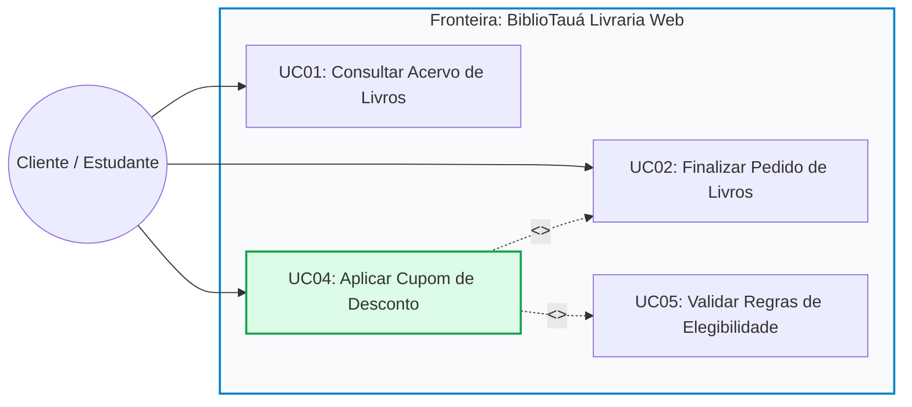
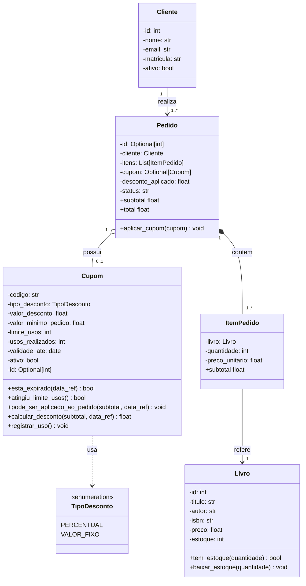

# Guia do Desenvolvedor: Sprint 04 — BiblioTauá (Encontro 1 / Aula 24)
## Casos de Uso, Diagrama de Classes, Arquitetura do Projeto e Início da Codificação

---

## 🎙️ 1. Fala de Abertura da Liderança Técnica (Tech Lead)

> **De:** Aline Mendes (Tech Lead — Equipe BiblioTauá)  
> **Para:** Equipe de Engenharia de Software  
> **Assunto:** Início da Sprint 04 — Módulo de Cupons e Políticas Promocionais  
>
> *"Olá, time de desenvolvimento do **BiblioTauá**! Sejam bem-vindos à Reunião de Planejamento da **Sprint 04**.*
>
> *Nosso sistema de livraria universitária já opera com sucesso nas vendas básicas do acervo didático (versão v0.3.0). Temos catálogo de livros, controle de estoque físico, cadastro de estudantes/clientes, carrinho de compras e banco SQLite funcionando perfeitamente.*
>
> *Para a próxima Feira do Livro do IFCE Campus Tauá, a diretoria acadêmica encomendou uma funcionalidade essencial: concessão de cupons de desconto aos discentes e servidores. Distribuímos as frentes de trabalho:*
>
> * 🖥️ **Mariana (Front-end Web / UI):** *Interface do carrinho no navegador.*
> * 💳 **Lucas (Back-end / Pagamentos):** *Integração com gateway bancário (PIX) para emitir cobrança do valor líquido.*
> * ⚙️ **VOCÊ (Desenvolvedor Júnior / Engenheiro de Software):** *Ficará com o coração do sistema: a **`TASK-204: Motor de Validação e Aplicação de Cupons de Desconto no Checkout`**.*
> * 🧪 **Beatriz (QA & DevOps):** *Acompanhará os testes de regressão e homologação.*
>
> *Atenção ao ritmo da equipe: hoje mesmo vamos compreender o Diagrama de Casos de Uso, a DUC e o Diagrama de Classes, e **já iniciaremos a implementação em Python** criando as exceções de domínio e a entidade `Cupom`!"*

---

## 📌 2. O Ticket da Sua Sprint: `TASK-204`

| Campo | Detalhes do Chamado |
| :--- | :--- |
| **Identificador:** | `TASK-204` |
| **Título:** | Implementação do Motor de Validação e Aplicação de Cupons de Desconto no Checkout de Livros |
| **Responsável:** | Discente (Desenvolvedor de Software) |
| **Prioridade:** | Alta (Bloqueante para o fechamento da Sprint 04) |
| **Estimativa:** | 4 Encontros de Trabalho (8 Horas-Aula) |
| **Branch Git:** | `feature/task-204-motor-cupons` |
| **Metas de Hoje:** | Diagramas UC + Classes $\rightarrow$ Arquitetura $\rightarrow$ Implementação de `exceptions.py` e `models/cupom.py` |

---

## 📐 3. Diagramas de Engenharia de Software (UML 2)

### 3.1 Diagrama de Casos de Uso (UML 2)



*   **$\ll$extend$\gg$ (Extensão):** O caso de uso `UC04: Aplicar Cupom de Desconto` estende opcionalmente o checkout em `UC02: Finalizar Pedido de Livros`. O cliente só insere o código promocional se desejar.
*   **$\ll$include$\gg$ (Inclusão):** Ao acionar `UC04`, o sistema executa compulsoriamente `UC05: Validar Regras de Elegibilidade`, averiguando validade, limite de usos e valor mínimo.

---

### 3.2 Documentação do Caso de Uso (DUC UC04)

*   **Identificador:** `UC04 -- Aplicar Cupom de Desconto`
*   **Ator Primário:** `Cliente / Discente`
*   **Pré-condições:** Carrinho não vazio e subtotal $> 0$.
*   **Pós-condições:** Desconto calculado e total do pedido atualizado.
*   **Fluxo Principal:** 
    1. O cliente informa o código alfanumérico do cupom na tela de checkout.
    2. O sistema recupera os parâmetros do cupom e valida as regras de negócio.
    3. O sistema calcula o valor do desconto (respeitando o teto do subtotal).
    4. O sistema atualiza o subtotal e o total a pagar.
*   **Fluxos Alternativos:**
    *   **FA01 (Desconto Percentual):** $\text{desconto} = \text{subtotal} \times (\text{valor\_desconto} / 100)$.
    *   **FA02 (Desconto em Valor Fixo):** $\text{desconto} = \min(\text{valor\_desconto}, \text{subtotal})$.
*   **Fluxos de Exceção (Mapeamento Direto em Código Python):**
    *   **FE01 (Cupom Inexistente ou Inativo):** Lança `CupomInexistenteError` ou `CupomInativoError`.
    *   **FE02 (Validade Ultrapassada):** Lança `CupomExpiradoError`.
    *   **FE03 (Cota de Usos Esgotada):** Lança `CupomEsgotadoError`.
    *   **FE04 (Subtotal Inferior ao Mínimo Exigido):** Lança `ValorMinimoNaoAtingidoError`.

---

### 3.3 Diagrama de Classes de Domínio (UML 2)



---

## 📂 4. Mapa da Arquitetura do Projeto: Pré-existente vs. TASK-204

### 4.1 Por que o repositório da Aula 24 tem mais arquivos do que o apresentado nos slides?

Em um ambiente profissional de desenvolvimento de software em equipe:
1. **Você nunca começa do zero a cada nova Sprint:** O sistema **BiblioTauá Livraria Web** já passou pelas Sprints 01, 02 e 03 (versão v0.3.0), nas quais foram construídos o catálogo de livros, controle de estoque físico, cadastro de clientes e fechamento básico de pedidos no SQLite.
2. **Integridade de Módulos em Python:** Um pacote Python (`bibliotaua`) requer que suas dependências e relações estruturais existam para que os imports funcionem (`from bibliotaua.models import ...`). Sem os arquivos pré-existentes, o projeto acusaria `ModuleNotFoundError`.
3. **Foco Pedagógico:** Nos slides, o professor foca cirurgicamente no **conteúdo novo da aula de hoje** (`exceptions.py` e `models/cupom.py`), enquanto o repositório mantém a infraestrutura completa para você poder rodar, testar e integrar o código em um cenário de software real.

### 4.2 Matriz de Responsabilidade dos Arquivos

| Arquivo | Camada / Papel | Origem | Elementos e Funções Principais |
| :--- | :--- | :--- | :--- |
| `bibliotaua/database.py` | Infraestrutura / Dados | **Pré-existente (v0.3.0)** | Criação da conexão SQLite (`get_connection`) e execução dos scripts DDL para criação das tabelas `clientes`, `livros`, `pedidos` e `itens_pedido`. Na Aula 25 receberá a tabela `cupons`. |
| `bibliotaua/models/cliente.py` | Domínio / Entidade | **Pré-existente (v0.3.0)** | Classe `@dataclass Cliente`: representa o cliente/estudante (`id`, `nome`, `email`, `matricula`, `ativo`). |
| `bibliotaua/models/livro.py` | Domínio / Entidade | **Pré-existente (v0.3.0)** | Classe `@dataclass Livro`: catálogo de livros (`id`, `titulo`, `autor`, `isbn`, `preco`, `estoque`). Métodos de regra: `tem_estoque(qtd)`, `baixar_estoque(qtd)`. |
| `bibliotaua/models/item_pedido.py` | Domínio / Item Associativo | **Pré-existente (v0.3.0)** | Classe `@dataclass ItemPedido`: linha de um pedido (`livro`, `quantidade`, `preco_unitario`). Propriedade calculada `subtotal = quantidade * preco_unitario`. |
| `bibliotaua/models/pedido.py` | Domínio / Aggregate Root | **Pré-existente (v0.3.0)** | Classe `@dataclass Pedido`: fechamento da compra (`cliente`, `itens`, `status`, `data_pedido`). Propriedades `subtotal` e `total`. Na Aula 26 receberá o método `aplicar_cupom(cupom)`. |
| `bibliotaua/repositories/livro_repository.py` | Persistência / Dados | **Pré-existente (v0.3.0)** | Classe `LivroRepository`: operações CRUD no SQLite para o catálogo (`buscar_por_id`, `listar_todos`, `atualizar_estoque`). |
| `bibliotaua/repositories/pedido_repository.py` | Persistência / Dados | **Pré-existente (v0.3.0)** | Classe `PedidoRepository`: salva pedidos e itens em transação atômica SQLite (`salvar`, `buscar_por_id`). |
| `bibliotaua/exceptions.py` | Domínio / Exceções | **NOVO (Aula 24 - TASK-204)** | Hierarquia de erros de negócio derivados dos Fluxos de Exceção (FE01 a FE04) da DUC UC04. |
| `bibliotaua/models/cupom.py` | Domínio / Entidade | **NOVO (Aula 24 - TASK-204)** | Classe `@dataclass Cupom` e enum `TipoDesconto`. Métodos de negócio: `esta_expirado`, `atingiu_limite_usos`, `pode_ser_aplicado_ao_pedido`, `calcular_desconto`, `registrar_uso`. |
| `main.py` | Ponto de Entrada / Teste | **NOVO (Aula 24 - TASK-204)** | Script criado pelo aluno para instanciar a entidade `Cupom`, testar cálculos de desconto e validar o disparo de exceções. |

---

## 💻 5. Roteiro de Implementação Mão na Massa (Live Coding)

### 5.1 Preparação do Ambiente de Trabalho
1. Baixe o pacote inicial **[`projeto_aluno.zip`](projeto_aluno.zip)** e descompacte em sua máquina (ou acesse a pasta `projeto_aluno/`).
2. Abra a pasta no **VS Code**.
3. Siga as tarefas abaixo implementando os arquivos `exceptions.py` e `models/cupom.py`.
4. Em seguida, crie o arquivo `main.py` na raiz do projeto para testar sua implementação!

### Tarefa 1: Implementar Hierarquia de Exceções (`bibliotaua/exceptions.py`)

No arquivo `bibliotaua/exceptions.py`, implementamos as exceções especializadas:

```python
"""
Módulo de Exceções de Domínio - BiblioTauá
Define as exceções de negócio mapeadas a partir dos Fluxos de Exceção da DUC UC04.
"""

class BiblioTauaException(Exception):
    """Exceção base para regras de negócio do BiblioTauá."""
    pass


class CupomInvalidoError(BiblioTauaException):
    """Lançada quando um cupom viola regras gerais de elegibilidade."""
    pass


class CupomInexistenteError(CupomInvalidoError):
    def __init__(self, codigo: str):
        super().__init__(f"Cupom '{codigo}' não encontrado no sistema.")
        self.codigo = codigo


class CupomInativoError(CupomInvalidoError):
    def __init__(self, codigo: str):
        super().__init__(f"O cupom '{codigo}' encontra-se desativado temporariamente.")
        self.codigo = codigo


class CupomExpiradoError(CupomInvalidoError):
    def __init__(self, codigo: str, validade_ate: str):
        super().__init__(f"O cupom '{codigo}' expirou em {validade_ate}.")
        self.codigo = codigo
        self.validade_ate = validade_ate


class CupomEsgotadoError(CupomInvalidoError):
    def __init__(self, codigo: str, limite: int):
        super().__init__(f"O cupom '{codigo}' atingiu a quantidade máxima de {limite} usos e esgotou.")
        self.codigo = codigo
        self.limite = limite


class ValorMinimoNaoAtingidoError(CupomInvalidoError):
    def __init__(self, codigo: str, valor_minimo: float, subtotal_atual: float):
        super().__init__(
            f"O cupom '{codigo}' exige pedido mínimo de R$ {valor_minimo:.2f}. "
            f"Subtotal atual: R$ {subtotal_atual:.2f}."
        )
        self.codigo = codigo
        self.valor_minimo = valor_minimo
        self.subtotal_atual = subtotal_atual
```

---

### Tarefa 2: Implementar a Entidade `Cupom` (`bibliotaua/models/cupom.py`)

No arquivo `bibliotaua/models/cupom.py`, implementamos a classe de domínio com seus métodos e validações:

```python
from dataclasses import dataclass
from datetime import datetime, date
from enum import Enum
from typing import Optional, Union

from bibliotaua.exceptions import (
    CupomInativoError,
    CupomExpiradoError,
    CupomEsgotadoError,
    ValorMinimoNaoAtingidoError
)

class TipoDesconto(str, Enum):
    PERCENTUAL = "PERCENTUAL"
    VALOR_FIXO = "VALOR_FIXO"


@dataclass
class Cupom:
    codigo: str
    tipo_desconto: TipoDesconto
    valor_desconto: float
    valor_minimo_pedido: float = 0.0
    limite_usos: int = 100
    usos_realizados: int = 0
    validade_ate: Union[str, date] = "2026-12-31"
    ativo: bool = True
    id: Optional[int] = None

    def __post_init__(self):
        self.codigo = self.codigo.strip().upper()
        if not self.codigo:
            raise ValueError("O código do cupom não pode ser vazio.")
        if self.valor_desconto <= 0:
            raise ValueError("O valor de desconto deve ser estritamente positivo.")
        if self.tipo_desconto == TipoDesconto.PERCENTUAL and self.valor_desconto > 100:
            raise ValueError("O desconto percentual não pode ser superior a 100%.")
        if self.valor_minimo_pedido < 0:
            raise ValueError("O valor mínimo do pedido não pode ser negativo.")
        if self.limite_usos <= 0:
            raise ValueError("O limite de utilizações deve ser de no mínimo 1.")
        if self.usos_realizados < 0:
            raise ValueError("A contagem de utilizações não pode ser negativa.")

    def obter_data_validade(self) -> date:
        if isinstance(self.validade_ate, str):
            return datetime.strptime(self.validade_ate, "%Y-%m-%d").date()
        return self.validade_ate

    def esta_expirado(self, data_referencia: Optional[date] = None) -> bool:
        hoje = data_referencia or date.today()
        return hoje > self.obter_data_validade()

    def atingiu_limite_usos(self) -> bool:
        return self.usos_realizados >= self.limite_usos

    def pode_ser_aplicado_ao_pedido(self, subtotal: float, data_referencia: Optional[date] = None) -> None:
        """Valida todas as regras de elegibilidade da DUC UC04."""
        if not self.ativo:
            raise CupomInativoError(self.codigo)
        if self.esta_expirado(data_referencia):
            validade_str = self.obter_data_validade().strftime("%d/%m/%Y")
            raise CupomExpiradoError(self.codigo, validade_str)
        if self.atingiu_limite_usos():
            raise CupomEsgotadoError(self.codigo, self.limite_usos)
        if subtotal < self.valor_minimo_pedido:
            raise ValorMinimoNaoAtingidoError(self.codigo, self.valor_minimo_pedido, subtotal)

    def calcular_desconto(self, subtotal: float, data_referencia: Optional[date] = None) -> float:
        """
        Calcula o desconto financeiro.
        Chama obrigatoriamente pode_ser_aplicado_ao_pedido para validar regras de negócio,
        inclusive a regra de valor mínimo de pedido.
        """
        self.pode_ser_aplicado_ao_pedido(subtotal, data_referencia)

        if self.tipo_desconto == TipoDesconto.PERCENTUAL:
            desconto = (subtotal * self.valor_desconto) / 100.0
        else:
            desconto = self.valor_desconto

        return round(min(desconto, subtotal), 2)

    def registrar_uso(self) -> None:
        if self.atingiu_limite_usos():
            raise CupomEsgotadoError(self.codigo, self.limite_usos)
        self.usos_realizados += 1
```

---

## 🧪 6. Testando a Implementação (`main.py`)

Para testar a implementação do cupom e das exceções, crie um arquivo **`main.py`** na raiz do projeto:

```python
"""
Ponto de Entrada e Teste da Implementação - Aula 24
Livraria BiblioTauá (Sprint 04 - TASK-204)
"""
from datetime import date, timedelta
from bibliotaua.models.cupom import Cupom, TipoDesconto
from bibliotaua.exceptions import ValorMinimoNaoAtingidoError

def main():
    print("--- Testando a Entidade Cupom (BiblioTauá) ---")

    # 1. Instanciando o cupom BEMVINDO10
    cupom = Cupom(
        codigo="BEMVINDO10",
        tipo_desconto=TipoDesconto.PERCENTUAL,
        valor_desconto=10.0,
        valor_minimo_pedido=50.0,
        validade_ate=date.today() + timedelta(days=5)
    )
    print(f"Cupom criado: {cupom.codigo} ({cupom.valor_desconto}% OFF)")

    # 2. Testando com subtotal válido (R$ 100.00)
    desconto = cupom.calcular_desconto(100.0)
    print(f"Subtotal R$ 100.00 -> Desconto calculado: R$ {desconto:.2f}")

    # 3. Testando regra de valor mínimo (R$ 30.00)
    try:
        cupom.calcular_desconto(30.0)
    except ValorMinimoNaoAtingidoError as erro:
        print(f"Subtotal R$ 30.00  -> Bloqueado com sucesso: {erro}")

if __name__ == "__main__":
    main()
```

### 6.1 Executando no Terminal

Na raiz do seu projeto, execute:

```bash
python3 main.py
```

**Saída esperada no terminal:**

```text
--- Testando a Entidade Cupom (BiblioTauá) ---
Cupom criado: BEMVINDO10 (10.0% OFF)
Subtotal R$ 100.00 -> Desconto calculado: R$ 10.00
Subtotal R$ 30.00  -> Bloqueado com sucesso: O cupom 'BEMVINDO10' exige pedido mínimo de R$ 50.00. Subtotal atual: R$ 30.00.
```

---

## 📝 7. Diário de Bordo da Sprint (Daily 1)

*   **O que realizei hoje?**
    *   Participei da Sprint Planning da Sprint 04 e assumi a responsabilidade pela `TASK-204`.
    *   Baixei o projeto base do aluno (`projeto_aluno.zip`) e compreendi a separação entre os módulos pré-existentes (v0.3.0) e as novas entregas.
    *   Interpretei o Diagrama de Casos de Uso (`UC02`, `UC04`, `UC05`) e mapeei os fluxos da DUC.
    *   Interpretei o Diagrama de Classes e modele a entidade `Cupom` e o enum `TipoDesconto`.
    *   Implementei `exceptions.py` com a hierarquia de exceções de negócio da livraria.
    *   Implementei `models/cupom.py` com validações no `__post_init__`, verificação de validade, contagem de usos e cálculo de desconto garantindo a validação do valor mínimo.
    *   Criei o arquivo `main.py` e executei o teste prático no terminal, confirmando o funcionamento de todas as regras.
*   **O que farei no Encontro 2 (Aula 25)?**
    *   Modelar a persistência relacional da tabela `cupons` no SQLite (`database.py`).
    *   Implementar o padrão repositório em `CupomRepository` com proteção contra SQL Injection.
*   **Impedimentos?** Nenhum impedimento.
