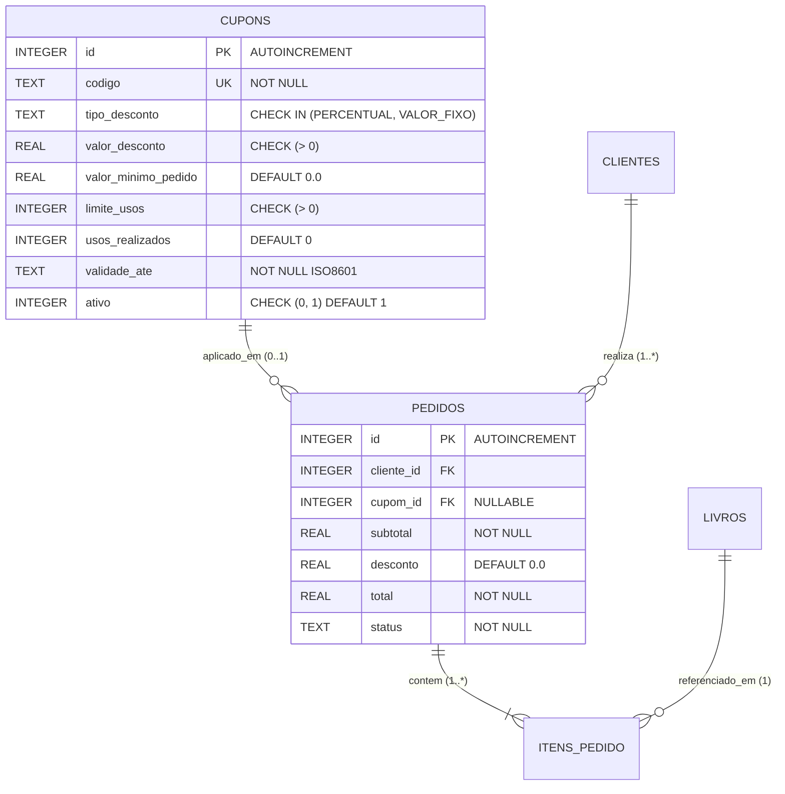
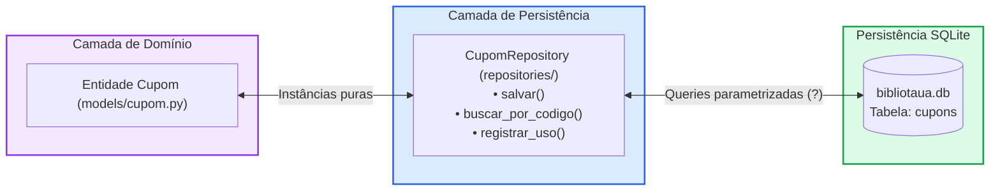

# Guia do Desenvolvedor: Sprint 04 - BiblioTauá (Encontro 2 / Aula 25)
## Persistência Relacional com SQLite e Padrão Repository

---

## 🎙️ 1. Alinhamento da Liderança Técnica (Daily Standup 2)

> **De:** Aline Mendes (Tech Lead — Equipe BiblioTauá)  
> **Para:** Equipe de Engenharia de Software  
> **Assunto:** Encontro 2 — Modelagem Relacional e Persistência Segura  
>
> *"Parabéns pelo ritmo acelerado no Encontro 1! A hierarquia de exceções e a entidade `Cupom` em Python ficaram excelentes.*
>
> *Hoje vamos resolver a persistência no banco de dados **SQLite** (`bibliotaua.db`). Precisamos criar a tabela `cupons`, adicionar a chave estrangeira em `pedidos` e implementar a camada de acesso a dados com o padrão **Repository**.*
>
> *Atenção aos nossos dois requisitos não funcionais críticos de segurança e consistência:*
> 1. *Blindagem 100% contra SQL Injection através de consultas parametrizadas com tuplas (`?`).*
> 2. *Incremento seguro e atômico no contador de utilizações do cupom, impedindo que requisições concorrentes ultrapassem o limite concedido.*
>
> *Mãos à obra e bom código!"*

---

## 📌 2. O Ticket da Sua Sprint: `TASK-204` (Etapa 2)

| Campo | Detalhes do Chamado |
| :--- | :--- |
| **Identificador:** | `TASK-204` |
| **Título:** | Persistência Relacional da Entidade Cupom no SQLite com Repositório Seguro |
| **Branch Git:** | `feature/task-204-motor-cupons` |
| **Entregas de Hoje:** | DER Relacional $\rightarrow$ DDL `cupons` (`database.py`) $\rightarrow$ `CupomRepository` |

---

## 📐 3. Diagramas de Engenharia de Software

### 3.1 Diagrama Entidade-Relacionamento: Esquema Físico Relacional (DER)



### 3.2 Diagrama de Arquitetura em Camadas (Repository Pattern)



---

## 💻 4. Roteiro de Implementação Mão na Massa (Live Coding)

### Tarefa 1: Script DDL SQLite (`bibliotaua/database.py`)

No arquivo `bibliotaua/database.py`, garanta a presença da tabela `cupons` e da chave estrangeira na tabela `pedidos`:

```sql
CREATE TABLE IF NOT EXISTS cupons (
    id INTEGER PRIMARY KEY AUTOINCREMENT,
    codigo TEXT NOT NULL UNIQUE,
    tipo_desconto TEXT NOT NULL CHECK(tipo_desconto IN ('PERCENTUAL', 'VALOR_FIXO')),
    valor_desconto REAL NOT NULL CHECK(valor_desconto > 0),
    valor_minimo_pedido REAL NOT NULL DEFAULT 0.0 CHECK(valor_minimo_pedido >= 0),
    limite_usos INTEGER NOT NULL DEFAULT 100 CHECK(limite_usos > 0),
    usos_realizados INTEGER NOT NULL DEFAULT 0 CHECK(usos_realizados >= 0),
    validade_ate TEXT NOT NULL,
    ativo INTEGER NOT NULL DEFAULT 1 CHECK(ativo IN (0, 1))
);

CREATE INDEX IF NOT EXISTS idx_cupons_codigo ON cupons(codigo);
```

### Tarefa 2: Implementar o `CupomRepository` (`bibliotaua/repositories/cupom_repository.py`)

Crie o arquivo `bibliotaua/repositories/cupom_repository.py`:

```python
import sqlite3
from datetime import date
from typing import Optional, List
from bibliotaua.models.cupom import Cupom, TipoDesconto
from bibliotaua.exceptions import CupomEsgotadoError

class CupomRepository:
    def __init__(self, conn: sqlite3.Connection):
        self.conn = conn

    def _row_para_objeto(self, row: sqlite3.Row) -> Cupom:
        return Cupom(
            id=row["id"],
            codigo=row["codigo"],
            tipo_desconto=TipoDesconto(row["tipo_desconto"]),
            valor_desconto=float(row["valor_desconto"]),
            valor_minimo_pedido=float(row["valor_minimo_pedido"]),
            limite_usos=int(row["limite_usos"]),
            usos_realizados=int(row["usos_realizados"]),
            validade_ate=date.fromisoformat(row["validade_ate"]),
            ativo=bool(row["ativo"])
        )

    def salvar(self, cupom: Cupom) -> Cupom:
        cursor = self.conn.cursor()
        cursor.execute("""
            INSERT INTO cupons (
                codigo, tipo_desconto, valor_desconto, valor_minimo_pedido,
                limite_usos, usos_realizados, validade_ate, ativo
            ) VALUES (?, ?, ?, ?, ?, ?, ?, ?)
        """, (
            cupom.codigo,
            cupom.tipo_desconto.value,
            cupom.valor_desconto,
            cupom.valor_minimo_pedido,
            cupom.limite_usos,
            cupom.usos_realizados,
            cupom.validade_ate.isoformat(),
            1 if cupom.ativo else 0
        ))
        self.conn.commit()
        cupom.id = cursor.lastrowid
        return cupom

    def buscar_por_codigo(self, codigo: str) -> Optional[Cupom]:
        cursor = self.conn.cursor()
        cursor.execute("SELECT * FROM cupons WHERE codigo = ?", (codigo.strip().upper(),))
        row = cursor.fetchone()
        return self._row_para_objeto(row) if row else None

    def registrar_uso(self, cupom_id: int) -> bool:
        cursor = self.conn.cursor()
        cursor.execute("""
            UPDATE cupons
            SET usos_realizados = usos_realizados + 1
            WHERE id = ? AND usos_realizados < limite_usos AND ativo = 1
        """, (cupom_id,))
        self.conn.commit()
        if cursor.rowcount == 0:
            raise CupomEsgotadoError(0)
        return True
```

### Tarefa 3: Validar a Persistência Relacional via Script

Execute no terminal:
```bash
python3 -c "
import sqlite3
from bibliotaua.database import obter_conexao, inicializar_banco
from bibliotaua.repositories.cupom_repository import CupomRepository
from bibliotaua.models.cupom import Cupom, TipoDesconto
from datetime import date, timedelta

conn = obter_conexao(':memory:')
inicializar_banco(conn)
repo = CupomRepository(conn)

novo_cupom = Cupom('TESTE20', TipoDesconto.PERCENTUAL, 20.0, validade_ate=date.today()+timedelta(days=10))
repo.salvar(novo_cupom)

recuperado = repo.buscar_por_codigo('TESTE20')
print('Cupom persistido e recuperado com ID:', recuperado.id, 'Codigo:', recuperado.codigo)
"
```

---

## 📝 5. Diário de Bordo da Sprint (Daily 2)

*   **O que realizei hoje?**
    *   Projetei o DER físico com tabelas `cupons` e `pedidos` interligadas.
    *   Defini constraints `CHECK`, `UNIQUE` e índice no SQLite (`database.py`).
    *   Implementei `CupomRepository` com proteção total contra SQL Injection.
    *   Implementei a operação de baixa concorrente segura em `registrar_uso()`.
*   **O que farei no próximo encontro (Aula 26)?**
    *   Compreender o Diagrama de Sequência do checkout.
    *   Implementar `CalculadoraDescontoService`, integrar o cupom ao agregado `Pedido` e orquestrar a compra em `CheckoutService`.
*   **Impedimentos?** Nenhum impedimento.
