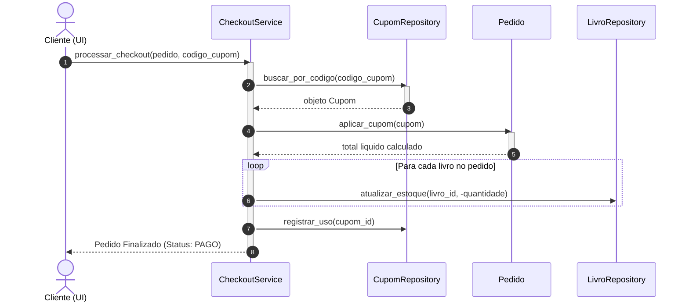
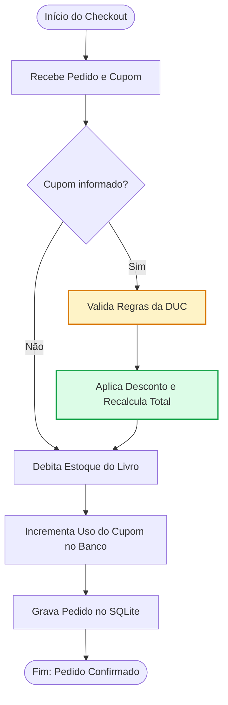

# Guia do Desenvolvedor: Sprint 04 - BiblioTauá (Encontro 3 / Aula 26)
## Diagrama de Sequência e Orquestração do Negócio

---

## 🎙️ 1. Alinhamento da Liderança Técnica (Daily Standup 3)

> **De:** Aline Mendes (Tech Lead — Equipe BiblioTauá)  
> **Para:** Equipe de Engenharia de Software  
> **Assunto:** Encontro 3 — Modelagem Dinâmica e Integração do Pedido ao Checkout  
>
> *"Excelente trabalho no Encontro 2! O nosso repositório no SQLite está seguro e a persistência de cupons está homologada.*
>
> *Hoje vamos realizar o coração da integração: transformar o **Diagrama de Sequência** em código vivo. Precisamos criar a `CalculadoraDescontoService`, adaptar o modelo de `Pedido` para aplicar cupons e calcular o total líquido, e construir o `CheckoutService` que orquestra a transação inteira: validação do cupom, baixa no estoque de livros e persistência do pedido.*
>
> *Com isso, nossa funcionalidade estará completa de ponta a ponta, pronta para a bateria de testes automatizados do Encontro 4!"*

---

## 📌 2. O Ticket da Sua Sprint: `TASK-204` (Etapa 3)

| Campo | Detalhes do Chamado |
| :--- | :--- |
| **Identificador:** | `TASK-204` |
| **Título:** | Orquestração do Checkout de Livros com Aplicação de Cupons e Baixa de Estoque |
| **Branch Git:** | `feature/task-204-motor-cupons` |
| **Entregas de Hoje:** | Diagrama de Sequência $\rightarrow$ `CalculadoraDescontoService` $\rightarrow$ `Pedido.aplicar_cupom()` $\rightarrow$ `CheckoutService` |

---

## 📐 3. Diagramas de Engenharia de Software

### 3.1 Diagrama de Sequência (UML 2)



### 3.2 Diagrama de Atividades do Checkout



---

## 💻 4. Roteiro de Implementação Mão na Massa (Live Coding)

### Tarefa 1: Implementar `CalculadoraDescontoService` (`bibliotaua/services/calculadora_desconto.py`)

```python
from bibliotaua.models.cupom import TipoDesconto

class CalculadoraDescontoService:
    @staticmethod
    def calcular(subtotal: float, tipo_desconto: TipoDesconto, valor_desconto: float) -> float:
        if subtotal <= 0:
            return 0.0

        if tipo_desconto == TipoDesconto.PERCENTUAL:
            desconto = subtotal * (valor_desconto / 100.0)
        elif tipo_desconto == TipoDesconto.VALOR_FIXO:
            desconto = min(valor_desconto, subtotal)
        else:
            raise ValueError(f"Tipo de desconto desconhecido: {tipo_desconto}")

        return round(desconto, 2)
```

### Tarefa 2: Integrar o Cupom ao `Pedido` (`bibliotaua/models/pedido.py`)

Adicione o suporte a cupom no modelo de pedidos:

```python
from typing import List, Optional
from bibliotaua.models.cliente import Cliente
from bibliotaua.models.item_pedido import ItemPedido
from bibliotaua.models.cupom import Cupom

class Pedido:
    def __init__(self, cliente: Cliente, id: Optional[int] = None):
        self.id = id
        self.cliente = cliente
        self.itens: List[ItemPedido] = []
        self.cupom: Optional[Cupom] = None
        self.desconto_aplicado: float = 0.0
        self.status: str = "CRIADO"

    def adicionar_item(self, item: ItemPedido):
        self.itens.append(item)

    @property
    def subtotal(self) -> float:
        return round(sum(item.subtotal for item in self.itens), 2)

    def aplicar_cupom(self, cupom: Cupom) -> float:
        desconto = cupom.calcular_desconto(self.subtotal)
        self.cupom = cupom
        self.desconto_aplicado = desconto
        return self.desconto_aplicado

    @property
    def total(self) -> float:
        return max(round(self.subtotal - self.desconto_aplicado, 2), 0.0)
```

### Tarefa 3: Implementar o `CheckoutService` (`bibliotaua/services/checkout_service.py`)

```python
from typing import Optional
from bibliotaua.models.pedido import Pedido
from bibliotaua.repositories.cupom_repository import CupomRepository
from bibliotaua.repositories.livro_repository import LivroRepository
from bibliotaua.repositories.pedido_repository import PedidoRepository
from bibliotaua.exceptions import CupomInexistenteError

class CheckoutService:
    def __init__(
        self,
        cupom_repo: CupomRepository,
        livro_repo: LivroRepository,
        pedido_repo: PedidoRepository
    ):
        self.cupom_repo = cupom_repo
        self.livro_repo = livro_repo
        self.pedido_repo = pedido_repo

    def processar_checkout(self, pedido: Pedido, codigo_cupom: Optional[str] = None) -> Pedido:
        # 1. Aplicar Cupom se informado
        if codigo_cupom:
            cupom = self.cupom_repo.buscar_por_codigo(codigo_cupom)
            if not cupom:
                raise CupomInexistenteError(codigo_cupom)
            pedido.aplicar_cupom(cupom)

        # 2. Debitar estoque de livros
        for item in pedido.itens:
            self.livro_repo.atualizar_estoque(item.livro.id, -item.quantidade)

        # 3. Registrar uso do cupom se aplicável
        if pedido.cupom and pedido.cupom.id:
            self.cupom_repo.registrar_uso(pedido.cupom.id)

        # 4. Gravar pedido
        pedido.status = "PAGO"
        return self.pedido_repo.salvar(pedido)
```

---

## 📝 5. Diário de Bordo da Sprint (Daily 3)

*   **O que realizei hoje?**
    *   Interpretei o Diagrama de Sequência UML do checkout da livraria.
    *   Implementei o serviço desacoplado de cálculo `CalculadoraDescontoService`.
    *   Integrei a aplicação do cupom à classe de agregado `Pedido`.
    *   Construí o `CheckoutService` com controle transacional de estoque e cupons.
*   **O que farei no próximo encontro (Aula 27 - Fechamento)?**
    *   Implementar e rodar a suíte de testes com Pytest.
    *   Demonstrar a aplicação no CLI interativo.
    *   Submeter o Pull Request final e elaborar o Relatório da Sprint.
*   **Impedimentos?** Nenhum impedimento.
