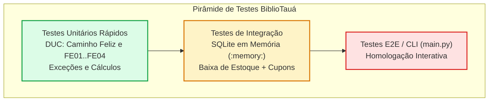
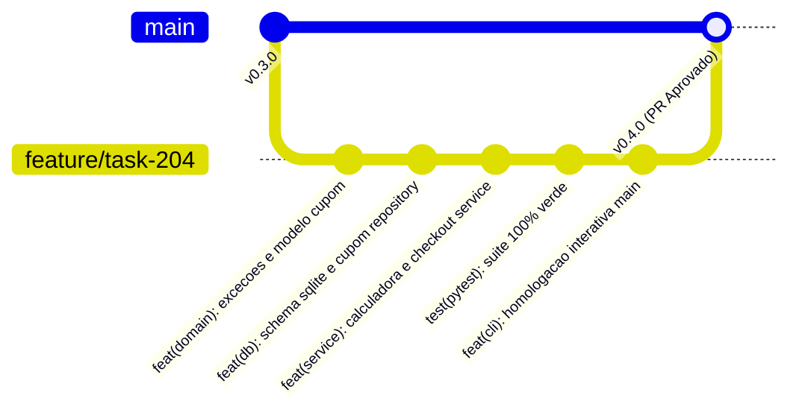

# Guia do Desenvolvedor: Sprint 04 - BiblioTauá (Encontro 4 / Aula 27)
## Garantia de Qualidade (Pytest), CLI e Fechamento da Sprint

---

## 🎙️ 1. Alinhamento da Liderança Técnica (Daily Standup 4)

> **De:** Aline Mendes (Tech Lead — Equipe BiblioTauá)  
> **Para:** Equipe de Engenharia de Software  
> **Assunto:** Encontro 4 — Fechamento da Sprint 04 e Homologação Final  
>
> *"Chegamos ao último encontro da nossa sprint quinzenal! Toda a implementação do motor de validação e aplicação de cupons está de pé.*
>
> *Hoje o foco total é **Garantia de Qualidade (QA)**: precisamos garantir que nenhum bug passe despercebido antes de liberar a funcionalidade para os alunos do IFCE. Vocês devem executar a suíte com **Pytest** cobrindo 100% dos fluxos de exceção da DUC, rodar a demonstração executável no terminal (**CLI**), consolidar os commits no Git e abrir o **Pull Request** formal.*
>
> *Confio na qualidade do trabalho de vocês. Vamos fechar essa sprint quinzenal com 100% de aprovação!"*

---

## 📌 2. O Ticket da Sua Sprint: `TASK-204` (Etapa Final)

| Campo | Detalhes do Chamado |
| :--- | :--- |
| **Identificador:** | `TASK-204` |
| **Título:** | Testes Automatizados com Pytest, Demonstração no CLI e Pull Request da Sprint 04 |
| **Branch Git:** | `feature/task-204-motor-cupons` |
| **Status:** | `READY FOR REVIEW / HOMOLOGAÇÃO` |

---

## 📐 3. Diagramas de Engenharia de Software

### 3.1 Diagrama da Pirâmide de Testes e Rastreabilidade



### 3.2 Diagrama de Git Flow da Sprint 04



---

## 💻 4. Roteiro de Implementação Mão na Massa (Live Coding)

### Tarefa 1: Executar a Suíte de Testes Automatizados (`test_cupons.py`)

No terminal, execute o Pytest com flag de verbosidade:
```bash
PYTHONPATH=. pytest bibliotaua/tests/test_cupons.py -v
```

Resultado esperado (10/10 testes passando):
```
test_cupons.py::test_buscar_cupom_existente PASSED              [ 10%]
test_cupons.py::test_buscar_cupom_inexistente_retorna_none PASSED [ 20%]
test_cupons.py::test_aplicar_cupom_percentual_sucesso PASSED    [ 30%]
test_cupons.py::test_aplicar_cupom_valor_fixo_sucesso PASSED    [ 40%]
test_cupons.py::test_cupom_inativo_dispara_excecao PASSED       [ 50%]
test_cupons.py::test_cupom_expirado_dispara_excecao PASSED      [ 60%]
test_cupons.py::test_cupom_esgotado_dispara_excecao PASSED      [ 70%]
test_cupons.py::test_subtotal_abaixo_do_minimo_dispara_excecao PASSED [ 80%]
test_cupons.py::test_checkout_completo_com_cupom PASSED         [ 90%]
test_cupons.py::test_decremento_estoque_livros_no_checkout PASSED [100%]

============================== 10 passed in 0.03s ==============================
```

### Tarefa 2: Demonstração no CLI Interativo (`main.py`)

Execute o aplicativo:
```bash
python3 -m bibliotaua.main
```
Selecione a opção `2` (Simular Compra) e digite o cupom `VOLTAAULAS10` para verificar o abatimento no PIX.

---

## 🚀 5. Template de Pull Request (PR)

Submissão formal para homologação:

```markdown
# Pull Request: [TASK-204] Motor de Validação e Aplicação de Cupons no Checkout

## 🎯 Descrição das Mudanças
- Implementação da hierarquia de exceções customizadas em `bibliotaua/exceptions.py`.
- Modelagem e codificação da entidade `Cupom` em `bibliotaua/models/cupom.py`.
- Criação da tabela relacional `cupons` no SQLite (`bibliotaua/database.py`).
- Implementação de `CupomRepository` com proteção contra SQL Injection e incremento atômico.
- Implementação de `CalculadoraDescontoService` e integração com `Pedido`.
- Implementação de `CheckoutService` com controle transacional de estoque.
- Suíte completa de testes no Pytest com 10 cenários e 100% de sucesso.
- Interface interativa no CLI (`main.py`) homologada.

## 🧪 Evidências de Teste
- `pytest bibliotaua/tests/`: 10 passed in 0.03s.
- `main.py`: Simulação de compra com cupom executada com sucesso.

## 👥 Revisores
- Aline Mendes (@techlead-aline)
- Beatriz (@qa-beatriz)
```

---

## 📊 6. Relatório de Fechamento da Sprint 04

*   **Sprint Review (Demonstração):** O Módulo de Cupons da Livraria BiblioTauá foi concluído com sucesso, atendendo a todos os requisitos comportamentais da DUC e estruturais da UML 2.
*   **Sprint Retrospective (Lições Aprendidas):**
    *   *O que deu certo:* A conclusão dos diagramas e início do código logo na Aula 1 acelerou o aprendizado e distribuiu as tarefas de implementação de forma equilibrada nos 4 encontros.
    *   *O que podemos melhorar:* Aumentar a cobertura de testes para fluxos de concorrência com múltiplos threads.
*   **Status Final:** Sprint 04 100% Entregue e Concluída!
